# Catálogo de cartas y unidades

Generado por `tools/generar_catalogo.mjs` (`npm run catalogo`) a partir de los datos del juego (build 2026-10-15 13:24). **No se edita a mano.**

Cómo buscar: Ctrl+F por nombre, por `id` (el nombre interno que usa el código) o por una palabra del texto. El buscador visual está en `catalogo_cartas.html`.

La **fase** de cada Evento es la columna cuya pestaña se extiende hasta el texto en la carta original; el texto da el momento exacto dentro de la fase. Se define en la tabla `EV_FASE` de `js/expansions.js`.

**246 entradas** — Evento: 100 · Destino: 48 · Investigación: 25 · Héroe: 23 · Civiles Heroicos: 9 · Unidad especial: 9 · Súper Zed: 9 · Propagador: 2 · Rumor: 16 · Súper Arma: 5

## Eventos por fase

- **Fase 4R (4):** `artefacto`, `hace_falta`, `saqueadores`, `turba`
- **Fase de Infección (2):** `aqui_doctor`, `contaminacion`
- **Fase de los Zeds (44):** `agua`, `alcantarilla`, `asalto_a`, `asalto_b`, `asalto_f`, `asalto_m`, `bajo_pies`, `brote_local`, `campanas`, `caos_abs`, `caos_control`, `cardio`, `catastrofe`, `conductos`, `desde_lab`, `doc_problema`, `donde_todos`, `duros`, `entusiasma`, `errantes`, `experimentos`, `feria`, `flambeados`, `hinchados`, `irrupcion`, `mina`, `misterioso`, `no_comer`, `no_detendran`, `no_escapatoria`, `noche`, `noelle`, `oh_malo`, `oh_no`, `pelo`, `propagacion`, `que_demonios`, `que_diablos`, `que_olor`, `rapidos`, `renqueantes`, `resiste`, `resistentes`, `tsunami`
- **Fase de Acciones (43):** `accidente`, `armados`, `atajos`, `bomberos`, `cabana`, `civ_heroicos`, `crisis`, `descubrimiento`, `desesperacion`, `despensa`, `eficiencia`, `elwood`, `fin_b1`, `fin_g`, `fin_o`, `fin_r`, `fin_y`, `fortuna`, `frenesi`, `gente`, `granero`, `helicoptero`, `heroe_b`, `heroe_g`, `inteligentes`, `jornada`, `keepcalm`, `marines`, `materiales`, `misiles`, `monstruo`, `moteros`, `murcielagos`, `negacion`, `no_hay_tiempo`, `odio`, `panico`, `queda_alguno`, `rumores`, `shhh`, `soldados`, `super_enloq`, `toxicos`
- **Fases de los Zeds y de Acciones (1):** `fin_b2`
- **Sin fase (turno especial) (6):** `cerebros_b1`, `cerebros_b2`, `cerebros_g`, `cerebros_y1`, `cerebros_y2`, `guardia`

## Eventoes

### accidente — Accidente en el Laboratorio
Naranja (Nivel IV) · Acto 2 · **Fase de Acciones** · 4R: 1 · Infección: tirada de Brote · Alimentación: 1 dado · Zeds: Autovía → Túnel → Túnel · Acciones: 2

> Al inicio, tira 1 dado: 1-5 → añade una carta de Investigación Inicial al azar a la parte superior del mazo de Investigación; 6 → sin efecto.

Resuelve el código: phases.js › eventEffect: al inicio de la fase de Acciones

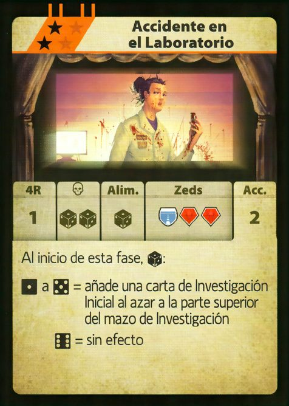

### agua — El suministro de agua se ha contaminado
Verde (Nivel II) · Acto 1 · **Fase de los Zeds** · 4R: 1 · Infección: tirada de Brote · Alimentación: 1 dado · Zeds: Montaña → Bosque · Acciones: 2

> Al inicio: tira 1 dado para determinar tus pérdidas. Pierdes esa cantidad en cualquier combinación de: a) Suministros, b) Impactos a unidades de jugador.

Resuelve el código: phases.js › eventEffect: al inicio de la fase de los Zeds

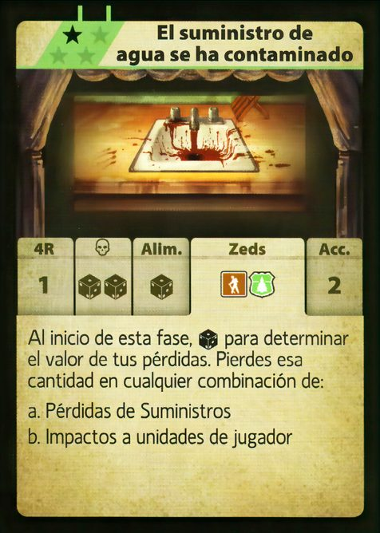

### alcantarilla — Zeds de alcantarilla
Naranja (Nivel IV) · Acto 2 · **Fase de los Zeds** · 4R: 0 · Infección: tirada de Brote · Alimentación: 1 · Zeds: Túnel → Túnel · Acciones: 1

> ¡Los Zeds emergen desde el Túnel! Al final de esta fase, todas las unidades Zed en los siguientes espacios del Túnel intentan moverse hacia la superficie (haz una tirada de Cripta primero): n.º 7 → espacio de la Universidad; n.º 6 → Central Nuclear; n.º 4 → Mina; n.º 3 y n.º 5 → Granja. Si no hay espacio, se quedan donde están.

Resuelve el código: phases.js › eventEffect: al inicio de la fase de los Zeds; phases.js › eventAfterZeds: al final de la fase de los Zeds; alcantarilla (Túnel)

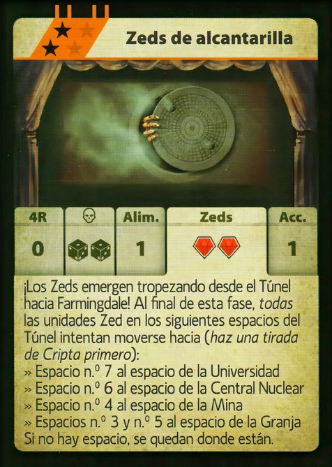

### aqui_doctor — ¡Aquí está el Doctor!
Naranja (Nivel IV) · Acto 2 · especial · **Fase de Infección** · 4R: 0 · Infección: No · Alimentación: 0 · Zeds: Autovía → Montaña → Túnel · Acciones: 1

> Al final de esta fase: 1. Incrementa la Infección a 13 de inmediato y resuelve un Brote Descontrolado.

Resuelve el código: phases.js › eventAfterInfection: al final de la fase de Infección

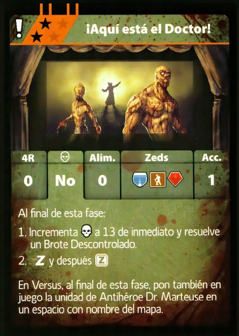

### armados — Civiles Bien Armados
Azul (Juego Básico y Nivel I) · Acto 1 · **Fase de Acciones** · 4R: 0 · Infección: No · Alimentación: 1 · Zeds: Bosque → Montaña · Acciones: 2

> Al inicio: pon la ficha de «Bien Armados» en una unidad de Civiles Normales. Hasta que acabe en el Cementerio recibe 1 columna a favor en todos sus combates Cuerpo a Cuerpo y ataques con Arma de Fuego.

Resuelve el código: phases.js › eventEffect: al inicio de la fase de Acciones

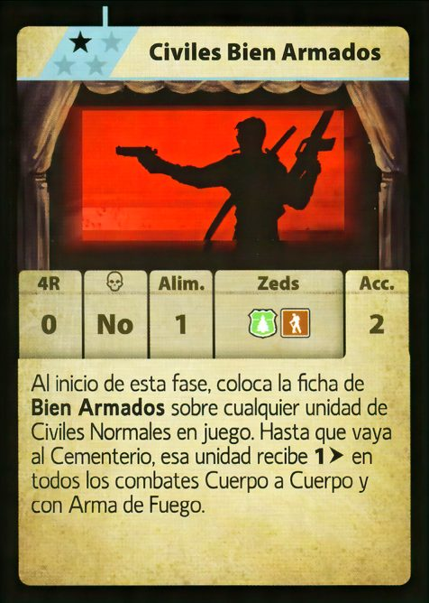

### artefacto — Encuentras un artefacto alienígena
Rojo (Nivel V) · Acto 2 · **Fase 4R** · 4R: 2 · Infección: tirada de Brote · Alimentación: 1 dado · Zeds: Autovía → Autovía → Túnel · Acciones: 3

> Al inicio, roba Destino: 1. Coloca una nueva unidad de Súper Zeds en el espacio número (1 dado) de la Ruta Destinada. 2. Revela sin coste la siguiente carta del mazo de Investigación.

Resuelve el código: phases.js › eventEffect: al inicio de la fase 4R

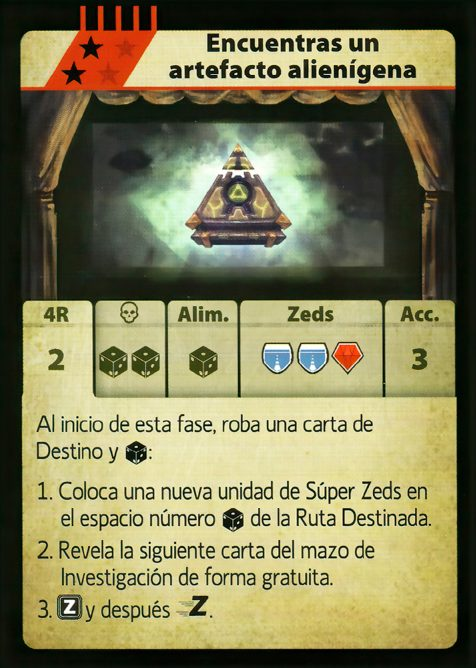

### asalto_a — Asalto nocturno en la Autovía
Azul (Juego Básico y Nivel I) · Acto 2 · **Fase de los Zeds** · 4R: 1 · Infección: tirada de Brote · Alimentación: 1 · Zeds: Autovía → Autovía · Acciones: 1

> Al inicio: +1 de Infección por cada unidad Zed en la ruta de la Autovía. Coloca un nuevo Zed en su espacio Inicial. Sin Modificador por Terreno para los defensores durante esta fase.

Resuelve el código: al inicio de los Zeds: +1 Infección por cada Zed de la ruta y un Zed nuevo en su Inicial

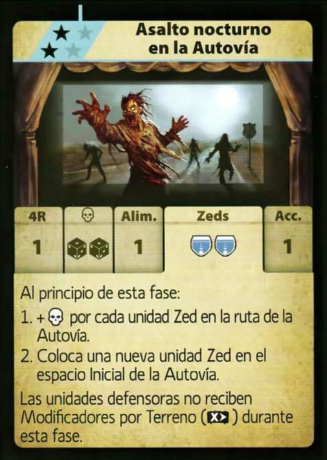

### asalto_b — Asalto nocturno en el Bosque
Azul (Juego Básico y Nivel I) · Acto 2 · **Fase de los Zeds** · 4R: 2 · Infección: tirada de Brote · Alimentación: 1 dado · Zeds: Bosque · Acciones: 2

> Al inicio: +1 de Infección por cada unidad Zed en la ruta del Bosque. Coloca un nuevo Zed en su espacio Inicial. Sin Modificador por Terreno para los defensores durante esta fase.

Resuelve el código: al inicio de los Zeds: +1 Infección por cada Zed de la ruta y un Zed nuevo en su Inicial

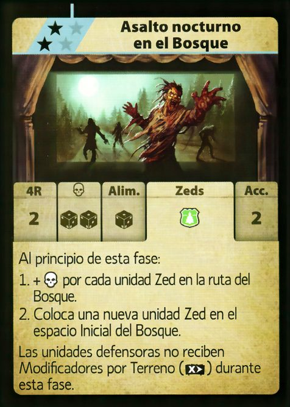

### asalto_f — Asalto nocturno en las Afueras
Azul (Juego Básico y Nivel I) · Acto 2 · **Fase de los Zeds** · 4R: 0 · Infección: tirada de Brote · Alimentación: 1 · Zeds: Afueras · Acciones: 2

> Al inicio: +1 de Infección por cada unidad Zed en la ruta de las Afueras. Coloca un nuevo Zed en su espacio Inicial. Sin Modificador por Terreno para los defensores durante esta fase.

Resuelve el código: al inicio de los Zeds: +1 Infección por cada Zed de la ruta y un Zed nuevo en su Inicial

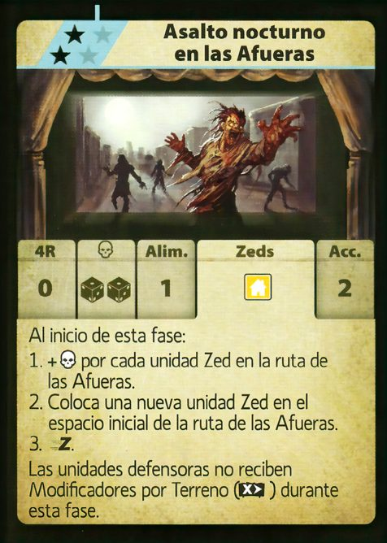

### asalto_m — Asalto nocturno en la Montaña
Azul (Juego Básico y Nivel I) · Acto 2 · **Fase de los Zeds** · 4R: 0 · Infección: tirada de Brote · Alimentación: 1 dado · Zeds: Montaña · Acciones: 1

> Al inicio: +1 de Infección por cada unidad Zed en la ruta de la Montaña. Coloca un nuevo Zed en su espacio Inicial. Las unidades defensoras no reciben Modificador por Terreno durante esta fase.

Resuelve el código: al inicio de los Zeds: +1 Infección por cada Zed de la ruta y un Zed nuevo en su Inicial

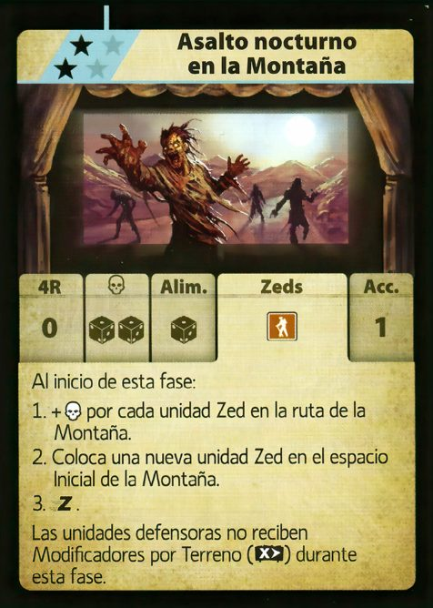

### atajos — «Atajos» experimentales
Rojo (Nivel V) · Acto 3 · **Fase de Acciones** · 4R: 1 · Infección: tirada de Brote · Alimentación: 1 · Zeds: Montaña → Autovía → Túnel · Acciones: 3

> Al inicio de esta fase, durante la cual puedes infligir 1 Impacto a un Héroe en el Laboratorio y tirar 1 dado: 1 = sin efecto; 2-6 = revela sin coste la siguiente carta del mazo de Investigación. Puedes hacer esto tantas veces como quieras.

Resuelve el código: phases.js › eventEffect: al inicio de la fase de Acciones

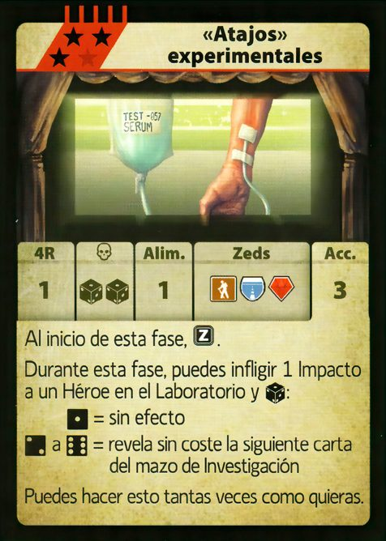

### bajo_pies — Justo bajo nuestros pies
Azul (Juego Básico y Nivel I) · Acto 2 · **Fase de los Zeds** · 4R: 0 · Infección: tirada de Brote · Alimentación: 0 · Zeds: Autovía → Afueras → Montaña · Acciones: 2

> Al inicio, roba Destino: elige una unidad de Civiles o Héroe en la Ruta Destinada (no en el Centro ni en un espacio Inicial): sufre de inmediato un ataque Cuerpo a Cuerpo en la columna «Igual» (aplica Modificadores por Terreno). Si eran Civiles Resistiendo, dejan de serlo. Tu unidad solo sufre Impactos, no se retira.

Resuelve el código: phases.js › eventEffect: al inicio de la fase de los Zeds

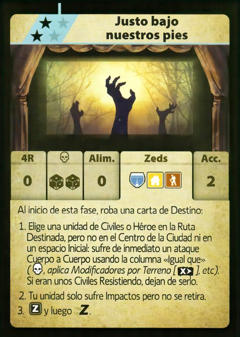

### bomberos — Los Aldeanos organizan unidades de bomberos
Naranja (Nivel IV) · Acto 3 · **Fase de Acciones** · 4R: 2 · Infección: tirada de Brote · Alimentación: 2 · Zeds: Túnel → Túnel → Montaña · Acciones: 3

> Al final de esta fase: puedes retirar cualquier cantidad de fichas de Caos en espacios de Pueblo; +1 de Infección por cada una que retires.

Resuelve el código: phases.js › eventEnd: al final de la fase de Acciones

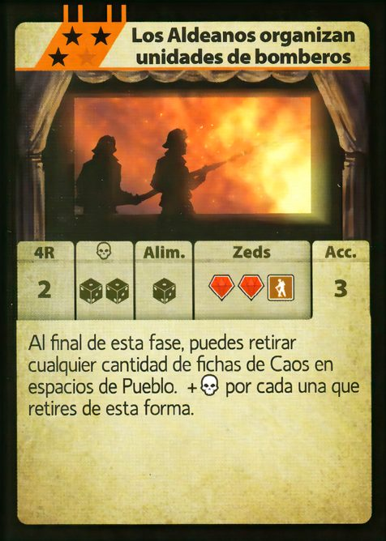

### brote_local — Brote local de Zeds
Rojo (Nivel V) · Acto 1 · **Fase de los Zeds** · 4R: 1 · Infección: tirada de Brote · Alimentación: 1 · Zeds: Afueras → Montaña → Túnel · Acciones: 2

> Al inicio, Z. Durante este turno, por cada unidad de Civiles Normales eliminada o ingresada en el Hospital (tras su tirada de Salvación), coloca una nueva unidad Zed en el espacio en el que fue eliminada y aplica el límite de agrupamiento si es necesario. Los nuevos Zeds no se mueven este turno.

Resuelve el código: phases.js › eventEffect: al inicio de la fase de los Zeds; bandera de turno: Civil eliminado = Brote local

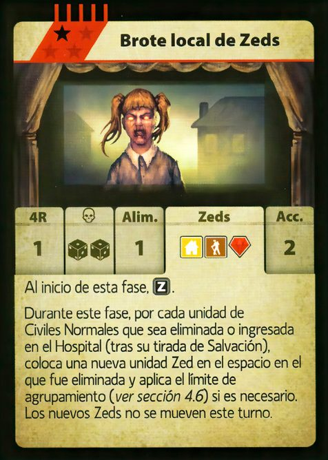

### cabana — Encuentras una cabaña de caza
Azul (Juego Básico y Nivel I) · Acto 1 · **Fase de Acciones** · 4R: 0 · Infección: No · Alimentación: 1 dado · Zeds: Montaña → Afueras · Acciones: 3

> Al final de esta fase: si una unidad de jugador está en el Campamento, obtienes 2 de Munición. (¡Botín!)

Resuelve el código: phases.js › eventEnd: al final de la fase de Acciones

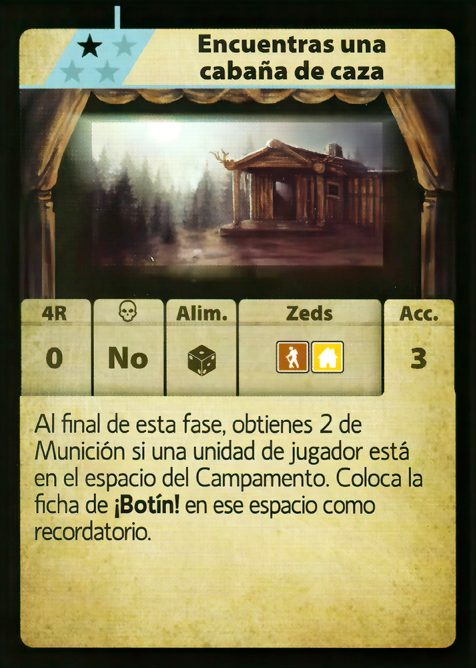

### campanas — Campanas en la cafetería del infierno
Amarillo (Nivel III) · Acto 4 · **Fase de los Zeds** · 4R: 2 · Infección: tirada de Brote · Alimentación: 0 · Zeds: Montaña → Bosque · Acciones: 2

> Al inicio: retira 1 Impacto, si es posible, a cada unidad Zed y Súper Zed en o adyacente a un espacio de Ciudad o de Pueblo sin unidades de jugador en él.

Resuelve el código: phases.js › eventEffect: al inicio de la fase de los Zeds

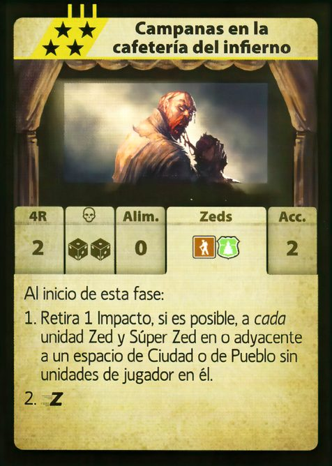

### caos_abs — Caos absoluto
Verde (Nivel II) · Acto 2 · **Fase de los Zeds** · 4R: 1 · Infección: tirada de Brote · Alimentación: 1 · Zeds: Bosque → Afueras → Montaña · Acciones: 3

> Cada espacio con nombre que pase a estar controlado por Zeds este turno recibe 2 fichas de Caos (en lugar de 1). Solo puedes retirar 1 ficha por turno en la fase de Mantenimiento.

Resuelve el código: bandera de turno: 2 fichas de Caos en lugar de 1 (al ocupar Zeds un espacio con nombre)

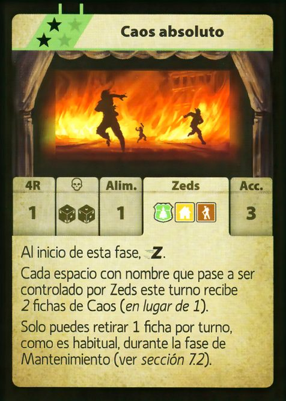

### caos_control — El caos se extiende sin control
Rojo (Nivel V) · Acto 3 · **Fase de los Zeds** · 4R: 1 · Infección: No · Alimentación: 0 · Zeds: Montaña → Túnel → Autovía · Acciones: 2

> Cada espacio con nombre que pase a estar controlado por Zeds este turno recibe 2 fichas de Caos (en lugar de 1). Solo puedes retirar 1 ficha por turno, como es habitual, durante la fase de Mantenimiento (ver sección 7.2).

Resuelve el código: bandera de turno: 2 fichas de Caos en lugar de 1 (al ocupar Zeds un espacio con nombre)

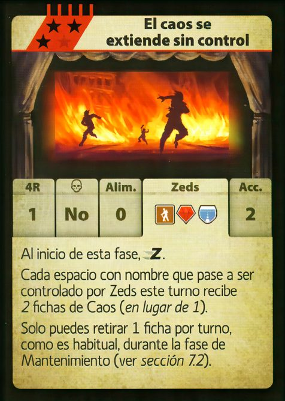

### cardio — Regla n.º 7: Cardio
Azul (Juego Básico y Nivel I) · Acto 1 · **Fase de los Zeds** · 4R: 1 · Infección: tirada de Brote · Alimentación: 1 · Zeds: Afueras → Afueras · Acciones: 1

> Al inicio: coloca 1 nueva unidad Zed en un espacio Inicial vacío (a tu elección); si no hay, en el Inicial con la unidad Zed de menor Fuerza. Si un Zed entra en un espacio con Civiles o un Héroe este turno, puedes retirar esa unidad en lugar de luchar.

Resuelve el código: phases.js › eventEffect: al inicio de la fase de los Zeds

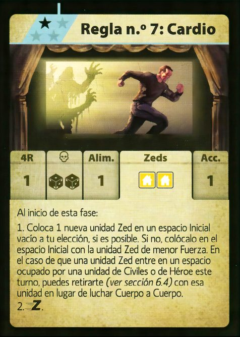

### catastrofe — Catástrofe nuclear
Amarillo (Nivel III) · Acto 2 · **Fase de los Zeds** · 4R: 1 · Infección: tirada de Brote · Alimentación: 1 dado · Zeds: Autovía → Bosque → Afueras · Acciones: 3

> Al inicio: comprueba el espacio de la Central Nuclear: 1. Cualquier unidad allí sufre 2 Impactos y se retira. 2. Coloca una ficha de Caos en ese espacio. 3. Ninguna unidad puede entrar allí este turno («No Pasar»).

Resuelve el código: phases.js › eventEffect: al inicio de la fase de los Zeds

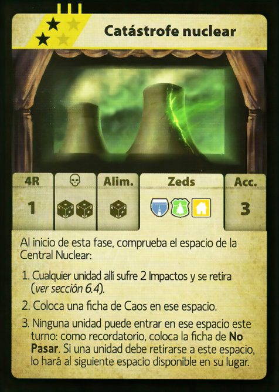

### cerebros_b1 — ¡CEREBROS!
Azul (Juego Básico y Nivel I) · Acto 3 · especial · **Sin fase (turno especial)** · 4R: 0 · Infección: No · Alimentación: 0 · Zeds: * · Acciones: 0

> Turno especial: +1 de Infección. Todas las rutas se activan (tú eliges el orden) y cada unidad Zed que gane un combate avanza otra vez de inmediato (repite si es necesario). Después, termina el turno: no hay fase de Acciones.

Resuelve el código: phases.js › eventEffect: al inicio de la fase de los Zeds; ¡CEREBROS!: turno especial sin fases normales

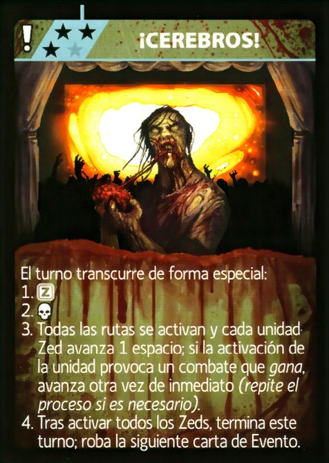

### cerebros_b2 — ¡CEREBROS!
Azul (Juego Básico y Nivel I) · Acto 4 · especial · **Sin fase (turno especial)** · 4R: 0 · Infección: No · Alimentación: 0 · Zeds: * · Acciones: 0

> Turno especial: +2 de Infección. Todas las rutas se activan y cada Zed que gane un combate avanza otra vez. No hay fase de Acciones.

Resuelve el código: phases.js › eventEffect: al inicio de la fase de los Zeds; ¡CEREBROS!: turno especial sin fases normales

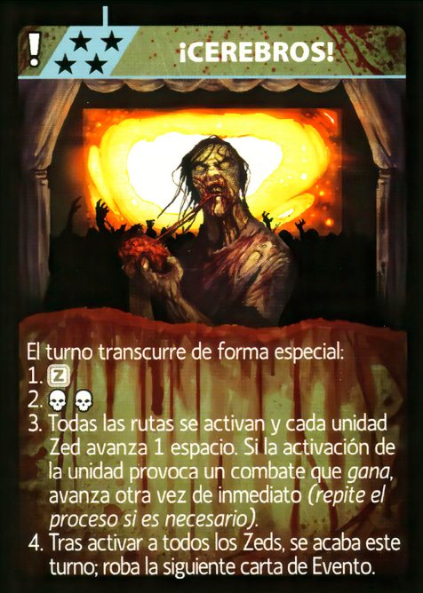

### cerebros_g — ¡CEREBROS!
Verde (Nivel II) · Acto 2 · especial · **Sin fase (turno especial)** · 4R: 0 · Infección: No · Alimentación: 0 · Zeds: * · Acciones: 0

> Turno especial: +3 de Infección. Todas las rutas se activan y cada Zed que gane un combate avanza otra vez. No hay fase de Acciones.

Resuelve el código: ¡CEREBROS!: turno especial sin fases normales

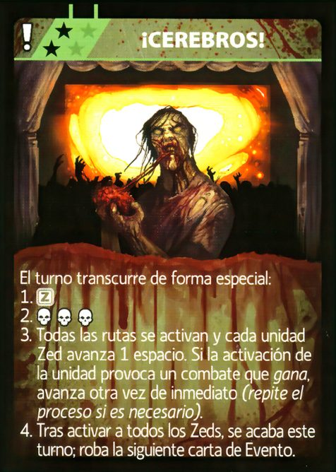

### cerebros_y1 — ¡CEREBROS!
Amarillo (Nivel III) · Acto 3 · especial · **Sin fase (turno especial)** · 4R: 0 · Infección: No · Alimentación: 0 · Zeds: * · Acciones: 0

> Turno especial: +2 de Infección. Todas las rutas se activan; cada Zed que gane un combate avanza otra vez. No hay fase de Acciones.

Resuelve el código: ¡CEREBROS!: turno especial sin fases normales

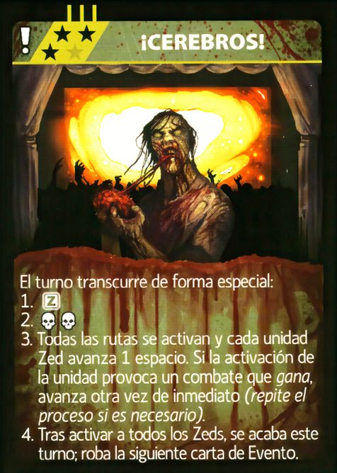

### cerebros_y2 — ¡CEREBROS!
Amarillo (Nivel III) · Acto 2 · especial · **Sin fase (turno especial)** · 4R: 0 · Infección: No · Alimentación: 0 · Zeds: * · Acciones: 0

> Turno especial: +4 de Infección. Todas las rutas se activan; cada Zed que gane un combate avanza otra vez. No hay fase de Acciones.

Resuelve el código: ¡CEREBROS!: turno especial sin fases normales

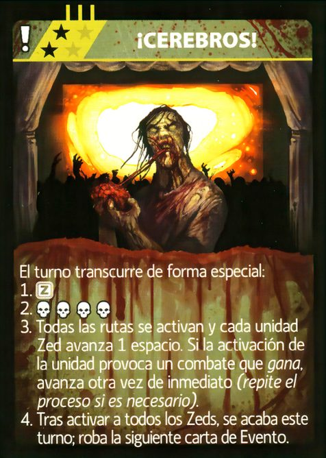

### civ_heroicos — Llegan Civiles Heroicos
Naranja (Nivel IV) · Acto 1 · **Fase de Acciones** · 4R: 1 · Infección: tirada de Brote · Alimentación: 1 dado · Zeds: Túnel → Autovía · Acciones: 2

> Al inicio: coge al azar una nueva unidad de Civiles Heroicos y colócala en el Centro de la Ciudad.

Resuelve el código: phases.js › eventEffect: al inicio de la fase de Acciones

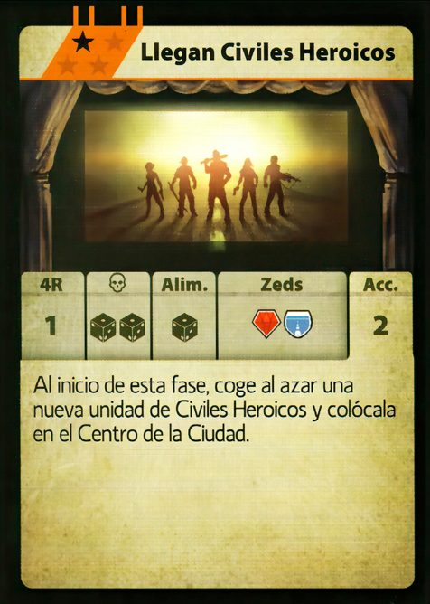

### conductos — Conexión por los conductos del vapor
Rojo (Nivel V) · Acto 3 · **Fase de los Zeds** · 4R: 1 · Infección: tirada de Brote · Alimentación: 0 · Zeds: Autovía → Autovía → Bosque → Bosque · Acciones: 3

> Al inicio de esta fase. Por cada unidad Zed en un espacio de Cripta, tira 1 dado: 1-2 = intenta entrar en la Central Nuclear; 3-5 = intenta entrar en la Granja (primero tira en la tabla de Cripta); 6 = no pasa nada. Si no hay sitio, se queda donde está.

Resuelve el código: phases.js › eventEffect: al inicio de la fase de los Zeds; phases.js › eventAfterZeds: al final de la fase de los Zeds; conductos (Túnel)

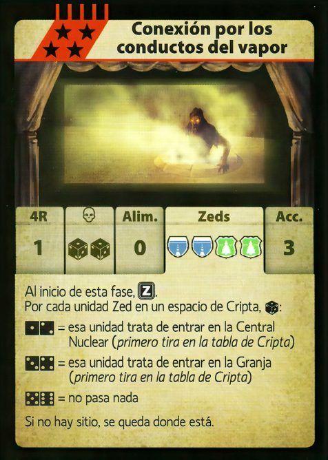

### contaminacion — Contaminación en el Hospital
Naranja (Nivel IV) · Acto 4 · **Fase de Infección** · 4R: 1 · Infección: tirada de Brote · Alimentación: 1 dado · Zeds: Afueras → Afueras → Túnel → Túnel · Acciones: 3

> Al inicio: 1. +1 de Infección por cada unidad en una Cama de Hospital y en las Oficinas del Personal. 2. Retira la ficha de Elwood Berra si está en juego.

Resuelve el código: phases.js › eventEffect: al inicio de la fase de Infección

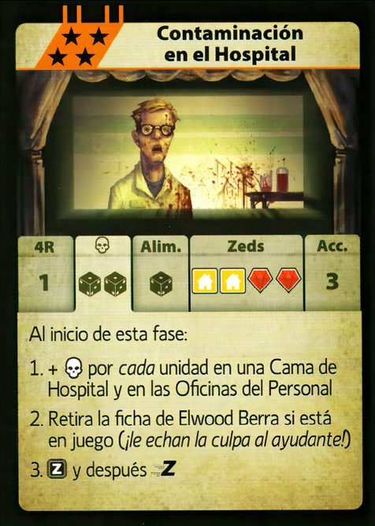

### crisis — Crisis nerviosa
Amarillo (Nivel III) · Acto 4 · **Fase de Acciones** · 4R: 1 · Infección: tirada de Brote · Alimentación: 1 dado · Zeds: Montaña → Autovía · Acciones: 1

> Al inicio: elige una unidad de Héroe en o adyacente al Centro de la Ciudad (pero no en una Cama de Hospital) y tira 1 dado: 1 = Suicida (sufre 2 Impactos); 2-5 = Autodestructivo (sufre 1 Impacto); 6 = «¡Estoy bien!» (sin efecto).

Resuelve el código: phases.js › eventEffect: al inicio de la fase de Acciones

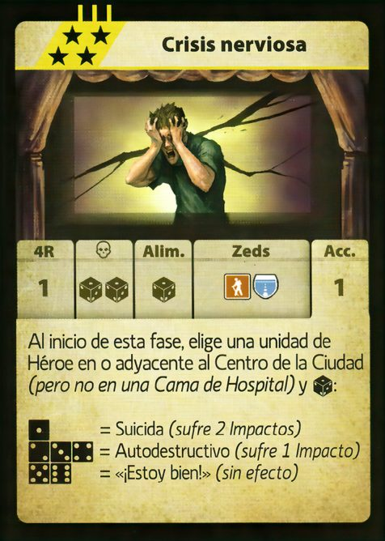

### descubrimiento — Descubrimiento en la Investigación
Amarillo (Nivel III) · Acto 2 · **Fase de Acciones** · 4R: 1 · Infección: tirada de Brote · Alimentación: 1 · Zeds: Autovía · Acciones: 2

> Al final de esta fase: si una unidad de jugador está en la Universidad, revela sin coste la siguiente carta de Investigación. (¡Botín!)

Resuelve el código: phases.js › eventEnd: al final de la fase de Acciones

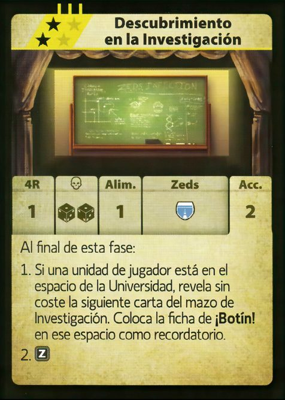

### desde_lab — Desde el laboratorio del Dr. Marteuse
Rojo (Nivel V) · Acto 3 · **Fase de los Zeds** · 4R: 1 · Infección: tirada de Brote · Alimentación: 1 dado · Zeds: Afueras → Bosque → Túnel · Acciones: 2

> Al inicio: a) Si no hay unidades de Súper Zeds en juego, coloca una nueva unidad de Súper Zeds en la Oficina del Dr. Marteuse. b) Si ya hay alguna unidad de Súper Zeds en juego, coloca una unidad Zed Normal allí en su lugar.

Resuelve el código: phases.js › eventEffect: al inicio de la fase de los Zeds

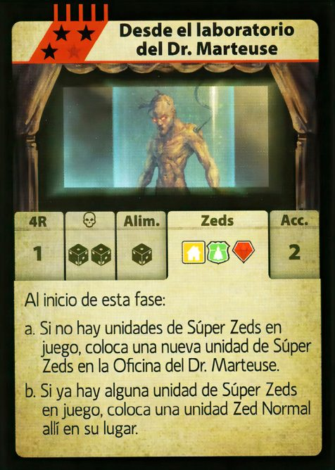

### desesperacion — Aumenta la desesperación
Amarillo (Nivel III) · Acto 3 · **Fase de Acciones** · 4R: 2 · Infección: tirada de Brote · Alimentación: 2 · Zeds: Autovía → Afueras → Bosque · Acciones: 2

> Al inicio: 1. Suma el número de unidades Zed (incluyendo Súper Zeds y Propagadores) en los espacios n.º 2, n.º 1 y n.º 0. 2. Pierdes esa cantidad en cualquier combinación de Suministros, Munición y/o Impactos a unidades de jugador.

Resuelve el código: phases.js › eventEffect: al inicio de la fase de Acciones

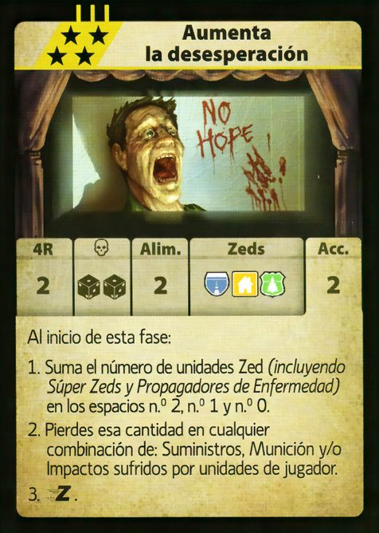

### despensa — Encuentras una despensa
Verde (Nivel II) · Acto 1 · **Fase de Acciones** · 4R: 0 · Infección: No · Alimentación: 1 dado · Zeds: Autovía → Montaña · Acciones: 2

> Al final de esta fase: si una unidad de jugador está en el Distrito Comercial, obtienes 4 Suministros. (¡Botín!)

Resuelve el código: phases.js › eventEnd: al final de la fase de Acciones

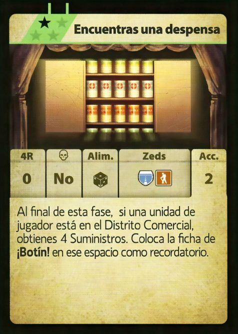

### doc_problema — Doc… Tenemos un gran problema
Rojo (Nivel V) · Acto 3 · **Fase de los Zeds** · 4R: 1 · Infección: tirada de Brote · Alimentación: 1 dado · Zeds: Bosque → Afueras → Túnel · Acciones: 3

> Al inicio: 1. +1 de Infección por cada unidad en una Cama de Hospital y en las Oficinas del Personal. 2. Retira la ficha de Elwood Berra si está en juego (¡le echan la culpa al ayudante!).

Resuelve el código: phases.js › eventEffect: al inicio de la fase de los Zeds

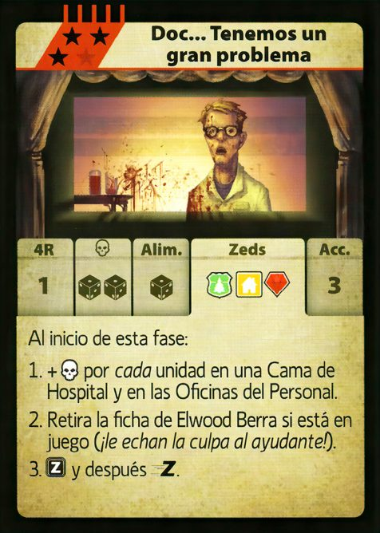

### donde_todos — ¿De dónde salen todos?
Verde (Nivel II) · Acto 3 · especial · **Fase de los Zeds** · 4R: 1 · Infección: No · Alimentación: 1 dado · Zeds: * · Acciones: 1

> Al inicio: 1. Coloca una nueva unidad Zed en cada espacio de Pueblo controlado por Zeds (límite de agrupamiento). 2. Retira todas las fichas de Impacto de los Zeds. Después se activan todas las rutas.

Resuelve el código: phases.js › eventEffect: al inicio de la fase de los Zeds

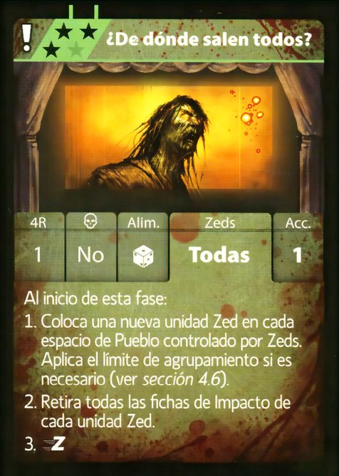

### duros — ¡Zeds duros de mollera!
Verde (Nivel II) · Acto 4 · **Fase de los Zeds** · 4R: 1 · Infección: tirada de Brote · Alimentación: 1 dado · Zeds: Montaña → Afueras · Acciones: 1

> Durante esta fase las unidades defensoras no reciben Modificadores por Terreno. Los Zeds destruyen de inmediato cualquier Barricada en un espacio al que entren, antes de resolver el combate.

Resuelve el código: bandera de turno: los defensores no reciben Modificador por Terreno; bandera de turno: los Zeds destruyen Barricadas al entrar

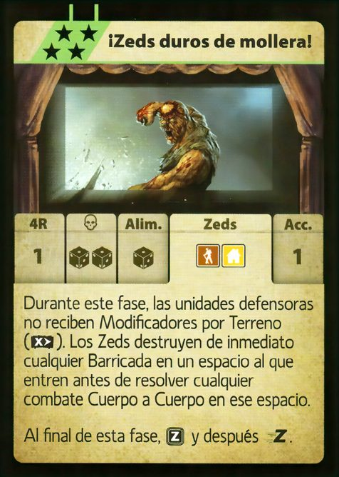

### eficiencia — Eficiencia en el Hospital
Verde (Nivel II) · Acto 4 · **Fase de Acciones** · 4R: 2 · Infección: tirada de Brote · Alimentación: 1 dado · Zeds: Afueras → Montaña → Autovía · Acciones: 2

> Durante esta fase, elige una opción: a) 2 Acciones de Curar gratis en el Hospital (sin reducir la Infección); b) −2 de Infección; c) −1 de Infección y 1 Acción de Curar gratis en el Hospital (sin reducir la Infección).

Resuelve el código: phases.js › eventEffect: al inicio de la fase de Acciones

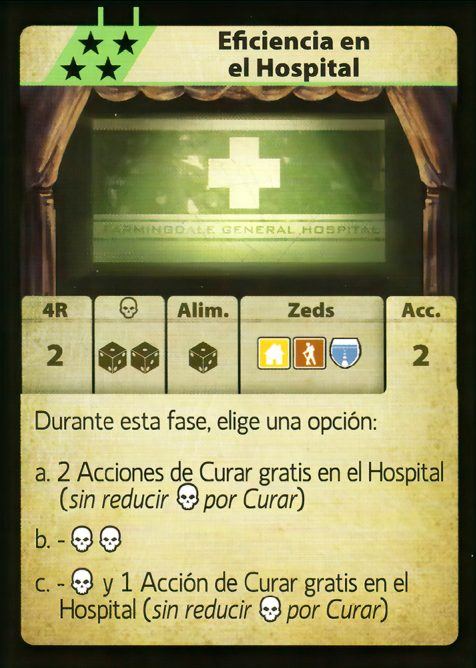

### elwood — Elwood Berra llega al Hospital
Naranja (Nivel IV) · Acto 3 · **Fase de Acciones** · 4R: 2 · Infección: tirada de Brote · Alimentación: 0 · Zeds: Bosque → Túnel · Acciones: 2

> Al inicio: coloca la ficha de Elwood Berra sobre el marcador de Infección. Proporciona −1 de Infección al final de cada fase de Mantenimiento.

Resuelve el código: phases.js › eventEffect: al inicio de la fase de Acciones

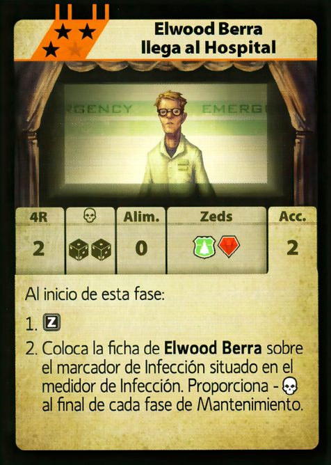

### entusiasma — ¡Esto me entusiasma tanto!
Azul (Juego Básico y Nivel I) · Acto 3 · **Fase de los Zeds** · Expansión 1 · 4R: 0 · Infección: tirada de Brote · Alimentación: 1 · Zeds: * · Acciones: 3

> Al inicio de esta fase, roba 1 carta de Destino: cada unidad de jugador en la Ruta Destinada (incluyendo el Centro) puede realizar de inmediato una Acción de Mover gratis o un ataque con Arma de Fuego gratis (necesita Munición).

Resuelve el código: phases.js › eventEffect: al inicio de la fase de los Zeds

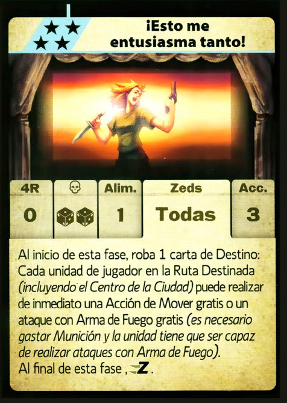

### errantes — Zeds errantes
Verde (Nivel II) · Acto 1 · **Fase de los Zeds** · 4R: 1 · Infección: tirada de Brote · Alimentación: 0 · Zeds: Autovía → Afueras → Bosque · Acciones: 1

> Al inicio, roba Destino: elige una unidad de Civiles o Héroe en la Ruta Destinada (no en el Centro ni en un espacio Inicial): sufre de inmediato un ataque Cuerpo a Cuerpo en la columna «Igual» (aplica Terreno). Solo sufre Impactos, no se retira.

Resuelve el código: phases.js › eventEffect: al inicio de la fase de los Zeds

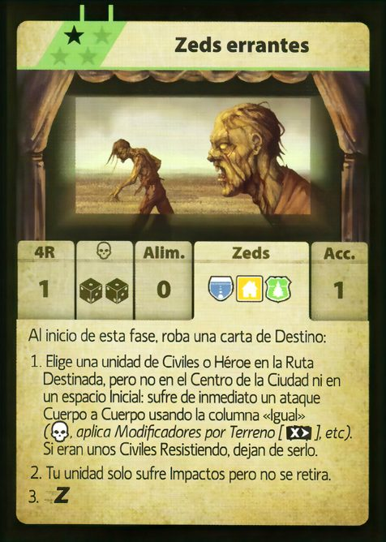

### experimentos — Experimentos explosivos
Rojo (Nivel V) · Acto 2 · **Fase de los Zeds** · 4R: 2 · Infección: tirada de Brote · Alimentación: 1 dado · Zeds: Bosque → Bosque → Afueras → Afueras · Acciones: 2

> Al inicio, tira 1 dado: 1-5 → añade una carta de Investigación Inicial al azar a la parte superior del mazo de Investigación; 6 → sin efecto. Aumenta la Infección en 1 dado.

Resuelve el código: phases.js › eventEffect: al inicio de la fase de los Zeds

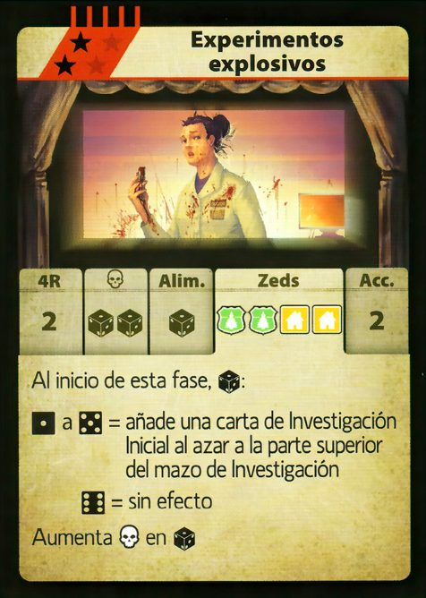

### feria — La feria de las tinieblas
Rojo (Nivel V) · Acto 2 · **Fase de los Zeds** · 4R: 0 · Infección: tirada de Brote · Alimentación: 1 dado · Zeds: * · Acciones: 3

> Después de moverse los Zeds, en cada espacio de Cripta tira 1 dado: 1 = coloca 2 nuevas unidades Zed en ese espacio; 2-5 = coloca 1 nueva unidad Zed; 6 = sin efecto.

Resuelve el código: phases.js › eventEffect: al inicio de la fase de los Zeds; phases.js › eventAfterZeds: al final de la fase de los Zeds

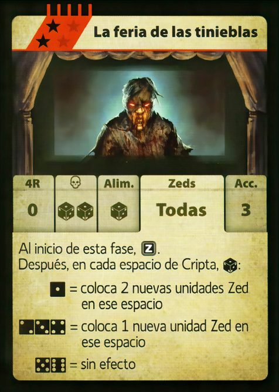

### fin_b1 — De una vez por todas, buenas noches
Azul (Juego Básico y Nivel I) · Acto Fin · **Fase de Acciones** · 4R: 1 · Infección: tirada de Brote · Alimentación: 1 dado · Zeds: Afueras → Montaña → Autovía → Autovía · Acciones: 0

> Al inicio de esta fase: ¡habéis ganado! «La melancolía te invade al despertar del estado de salvaje supervivencia…»

Resuelve el código: carta de Fin: se gana al terminar la fase de los Zeds (inicio de Acciones)

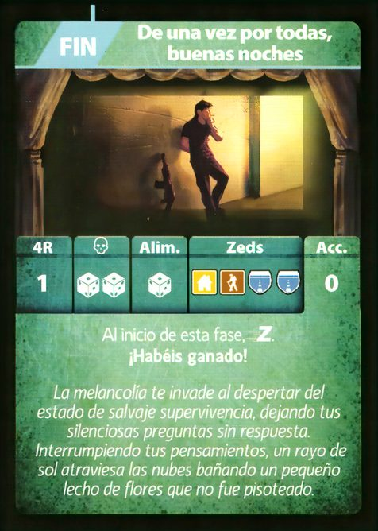

### fin_b2 — Para bien o para mal, yo soy el que tiene el arma
Azul (Juego Básico y Nivel I) · Acto Fin · **Fases de los Zeds y de Acciones** · 4R: 2 · Infección: tirada de Brote · Alimentación: 1 · Zeds: D2 · Acciones: 0

> Al inicio de la fase de los Zeds: roba Destino para saber qué ruta se activa 2 veces. Al inicio de la fase de Acciones, si seguís vivos: ¡habéis ganado!

Resuelve el código: carta de Fin: se gana al terminar la fase de los Zeds (inicio de Acciones)

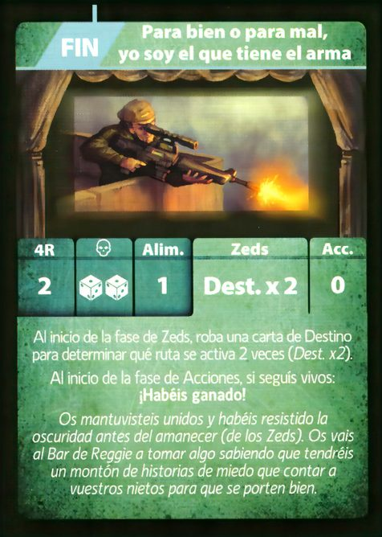

### fin_g — ¿Quieres un trozo de mí?
Verde (Nivel II) · Acto Fin · **Fase de Acciones** · 4R: 1 · Infección: tirada de Brote · Alimentación: 1 dado · Zeds: Montaña → Montaña → Bosque → Afueras · Acciones: 0

> ¡Habéis ganado! Durante un instante lamentáis vuestras pérdidas…

Resuelve el código: carta de Fin: se gana al terminar la fase de los Zeds (inicio de Acciones)

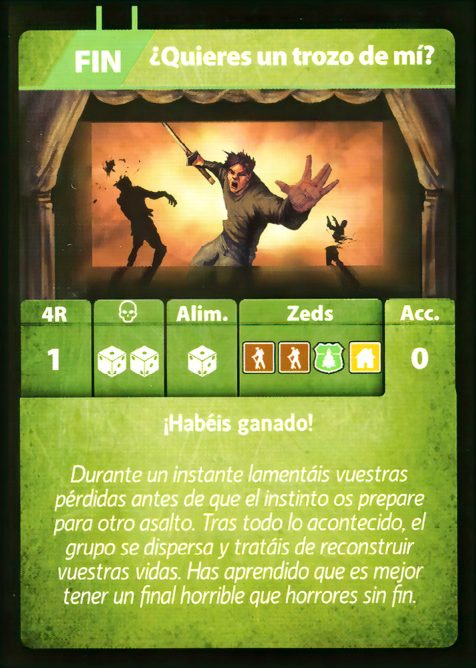

### fin_o — ¡Fin de la partida, tío!
Naranja (Nivel IV) · Acto Fin · **Fase de Acciones** · 4R: 0 · Infección: tirada de Brote · Alimentación: 2 · Zeds: * · Acciones: 0

> ¡Habéis ganado! Es difícil diferenciar a los malheridos supervivientes de los Zeds que antes atacaban…

Resuelve el código: carta de Fin: se gana al terminar la fase de los Zeds (inicio de Acciones)

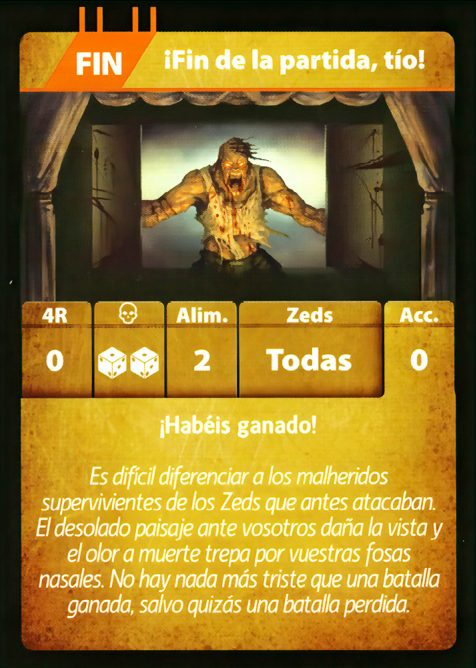

### fin_r — Por fin ha terminado la larga pesadilla
Rojo (Nivel V) · Acto Fin · **Fase de Acciones** · 4R: 0 · Infección: tirada de Brote · Alimentación: 2 · Zeds: * → * · Acciones: 0

> ¡Habéis ganado! Ninguno de los supervivientes volverá a ser el mismo…

Resuelve el código: carta de Fin: se gana al terminar la fase de los Zeds (inicio de Acciones)

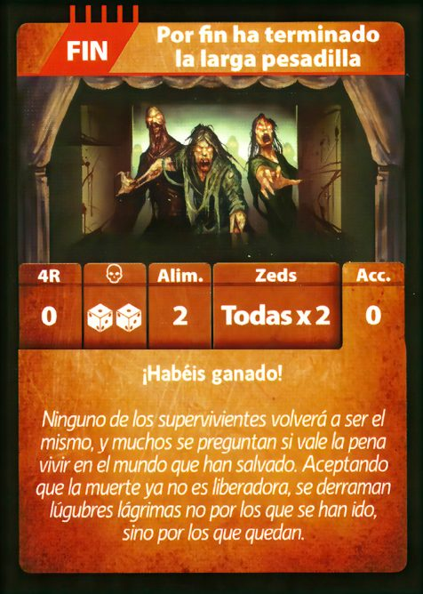

### fin_y — Es hora de actuar o callar
Amarillo (Nivel III) · Acto Fin · **Fase de Acciones** · 4R: 1 · Infección: tirada de Brote · Alimentación: 1 · Zeds: * · Acciones: 0

> ¡Habéis ganado! A tu alrededor todo es caos mientras los Zeds retroceden…

Resuelve el código: carta de Fin: se gana al terminar la fase de los Zeds (inicio de Acciones)

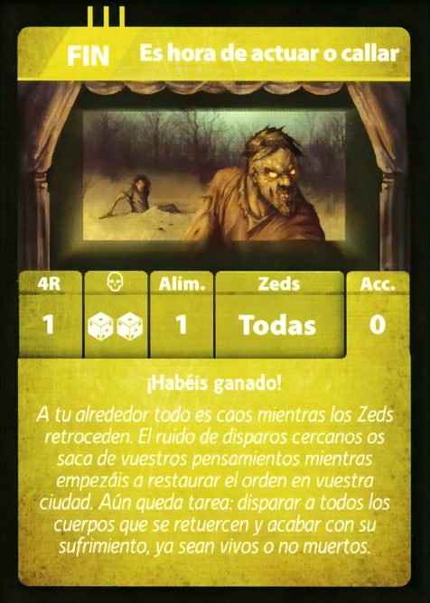

### flambeados — Zeds flambeados
Amarillo (Nivel III) · Acto 2 · **Fase de los Zeds** · 4R: 1 · Infección: No · Alimentación: 0 · Zeds: Montaña → Afueras · Acciones: 2

> Durante esta fase, cada unidad u Horda Zed que entre o salga de un espacio con Caos obtiene 2 columnas en contra en sus ataques Cuerpo a Cuerpo. Cada unidad Zed que entre o salga de un espacio con Caos sufre 1 Impacto tras mover (después de resolver el combate).

Resuelve el código: bandera de turno: Zeds flambeados (Caos)

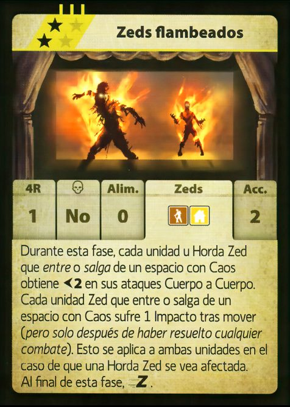

### fortuna — La fortuna favorece a los que se preparan
Azul (Juego Básico y Nivel I) · Acto 1 · **Fase de Acciones** · Expansión 2 · 4R: 1 · Infección: tirada de Brote · Alimentación: 1 dado · Zeds: Autovía → cualquier otra ruta (a tu elección) · Acciones: 1

> Al inicio de esta fase: cada Héroe y Civiles Heroicos en un espacio con nombre puede realizar gratis una Acción de Buscar.

Resuelve el código: al inicio de la fase de Acciones: Buscar gratis

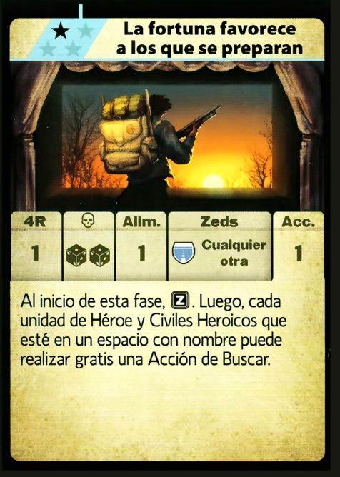

### frenesi — Frenesí Súper Zed
Naranja (Nivel IV) · Acto 4 · **Fase de Acciones** · 4R: 2 · Infección: tirada de Brote · Alimentación: 1 dado · Zeds: * · Acciones: 2

> Al final de esta fase: activa todos los Súper Zeds (solamente), empezando por los más cercanos al Centro. Obtienen 2 columnas en contra al atacar durante esta activación.

Resuelve el código: phases.js › eventEffect: al inicio de la fase de Acciones; phases.js › eventEnd: al final de la fase de Acciones

### gente — Gente, ¡vamos a movernos!
Azul (Juego Básico y Nivel I) · Acto 1 · **Fase de Acciones** · Expansión 2 · 4R: 2 · Infección: No · Alimentación: 1 dado · Zeds: Bosque → Montaña · Acciones: 4

> Durante esta fase son gratis todas las Acciones de Mover que se inicien en el Centro de la Ciudad.

Resuelve el código: bandera de turno: Mover gratis desde el Centro (fase de Acciones)

### granero — Encuentras un granero lleno
Amarillo (Nivel III) · Acto 1 · **Fase de Acciones** · 4R: 1 · Infección: tirada de Brote · Alimentación: 1 dado · Zeds: Montaña → Bosque · Acciones: 3

> Al final de esta fase: si una unidad de jugador está en la Granja, aumenta tus Suministros en 1 dado. (¡Botín!)

Resuelve el código: phases.js › eventEnd: al final de la fase de Acciones

### guardia — ¡Llega la Guardia Nacional!
Verde (Nivel II) · Acto 3 · especial · **Sin fase (turno especial)** · 4R: 0 · Infección: No · Alimentación: 0 · Zeds: — · Acciones: 0

> Roba una carta de Destino inmediatamente y coloca la unidad de la Guardia Nacional en el Inicial de la Ruta Destinada. Si indica el Túnel, pasa a ser a elección de los jugadores. La Guardia mueve 1 espacio cada fase 4R y 1 por Acción de Mover. Necesita 2 de Munición por ataque. Tras colocarla, se acaba este turno (roba la siguiente carta).

Resuelve el código: phases.js › eventEffect: al inicio de la fase de los Zeds; turno especial: coloca la Guardia Nacional y termina el turno

### hace_falta — Hace falta un Pueblo…
Naranja (Nivel IV) · Acto 2 · **Fase 4R** · 4R: 2 · Infección: tirada de Brote · Alimentación: 1 · Zeds: Túnel → Montaña · Acciones: 2

> Al inicio: 1. Sustituye una unidad de Aldeanos, Refugiados o Civiles en cualquier ruta por una nueva unidad Zed Normal. 2. Coloca la unidad reemplazada en el Hospital por su cara de Fuerza reducida con una ficha de ECG.

Resuelve el código: phases.js › eventEffect: al inicio de la fase 4R

### helicoptero — Ataque del helicóptero de la Guardia Nacional
Verde (Nivel II) · Acto 3 · **Fase de Acciones** · 4R: 1 · Infección: tirada de Brote · Alimentación: 0 · Zeds: Afueras → Autovía · Acciones: 3

> Al inicio: elige una unidad u Horda Zed en un espacio no Inicial de la superficie y tira 2 dados: 2-5 → 1 Impacto; 6-9 → 2 Impactos; 10-12 → 3 Impactos. Aplícalos a la unidad u Horda elegida.

Resuelve el código: phases.js › eventEffect: al inicio de la fase de Acciones

### heroe_b — Llega un Héroe
Azul (Juego Básico y Nivel I) · Acto 3 · **Fase de Acciones** · 4R: 1 · Infección: tirada de Brote · Alimentación: 0 · Zeds: Autovía → Afueras → Bosque · Acciones: 2

> Al inicio: coge un nuevo Héroe disponible al azar y colócalo en el Centro de la Ciudad o en cualquier espacio Inicial.

Resuelve el código: phases.js › eventEffect: al inicio de la fase de Acciones

### heroe_g — Llega un Héroe
Verde (Nivel II) · Acto 2 · **Fase de Acciones** · 4R: 2 · Infección: tirada de Brote · Alimentación: 1 dado · Zeds: Bosque → Afueras → Autovía · Acciones: 2

> Al inicio: coge un nuevo Héroe disponible al azar y colócalo en el Centro de la Ciudad o en cualquier espacio Inicial.

Resuelve el código: phases.js › eventEffect: al inicio de la fase de Acciones

### hinchados — Los Zeds hinchados estallan
Rojo (Nivel V) · Acto 3 · **Fase de los Zeds** · 4R: 1 · Infección: tirada de Brote · Alimentación: 1 dado · Zeds: Afueras → Autovía → Montaña · Acciones: 2

> Al inicio, roba Destino: 1. Elimina la unidad Zed (incluyendo Súper Zeds o Propagadores) más cercana al Centro en la Ruta Destinada. 2. Realiza un ataque independiente con Arma de Fuego de Fuerza 4 contra cada unidad adyacente de jugador o Zed. 3. Todas las unidades, incluyendo Refugiados, son afectadas por este ataque. Las unidades en espacios Iniciales no se ven afectadas.

Resuelve el código: phases.js › eventEffect: al inicio de la fase de los Zeds

### inteligentes — Zeds Inteligentes
Amarillo (Nivel III) · Acto 3 · **Fase de Acciones** · 4R: 1 · Infección: tirada de Brote · Alimentación: 1 dado · Zeds: Afueras → Afueras · Acciones: 3

> Al final de esta fase: 1. Coloca un nuevo Zed en el Inicial de las Afueras. 2. Pon la ficha de Inteligentes en el Zed Normal más fuerte: obtiene 1 columna en contra cuando ataca hasta que sea eliminado.

Resuelve el código: phases.js › eventEnd: al final de la fase de Acciones

### irrupcion — Una irrupción desde las profundidades
Rojo (Nivel V) · Acto 3 · **Fase de los Zeds** · 4R: 1 · Infección: tirada de Brote · Alimentación: 1 dado · Zeds: Túnel → Túnel · Acciones: 3

> ¡Los Zeds emergen tropezando desde el Túnel hacia Farmingdale! Al final de esta fase, todas las unidades Zed en los espacios del Túnel n.º 7, 6, 4, 3 y 5 intentan moverse a la superficie (Universidad, Central Nuclear, Mina, Granja; tirada de Cripta primero). Si no hay sitio, se quedan.

Resuelve el código: phases.js › eventEffect: al inicio de la fase de los Zeds; phases.js › eventAfterZeds: al final de la fase de los Zeds; alcantarilla (Túnel)

### jornada — Trabajando una jornada doble
Amarillo (Nivel III) · Acto 2 · **Fase de Acciones** · 4R: 1 · Infección: tirada de Brote · Alimentación: 1 · Zeds: Montaña → Autovía · Acciones: 3

> Durante esta fase puedes aumentar la Infección (hasta 3 veces). Cada vez que lo hagas puedes: a) obtener una Acción de Curar gratis o bien b) realizar una Acción de Investigar gratis.

Resuelve el código: phases.js › eventEffect: al inicio de la fase de Acciones

### keepcalm — «Keep calm» y mata Zeds
Azul (Juego Básico y Nivel I) · Acto 4 · **Fase de Acciones** · 4R: 1 · Infección: tirada de Brote · Alimentación: 0 · Zeds: Montaña → Autovía · Acciones: 2

> Al inicio: elige un Héroe en juego; obtiene 2 columnas a favor al atacar Cuerpo a Cuerpo únicamente este turno (solo si es el atacante).

Resuelve el código: phases.js › eventEffect: al inicio de la fase de Acciones

### marines — El equipo de Marines despliega sus tropas
Verde (Nivel II) · Acto 2 · **Fase de Acciones** · 4R: 1 · Infección: tirada de Brote · Alimentación: 1 · Zeds: Montaña → Autovía · Acciones: 2

> Al inicio, roba Destino: 1. Coloca la unidad de Marines en el espacio Inicial de la Ruta Destinada. 2. +4 de Munición. Los Marines mueven 1 espacio cada fase 4R y hasta 3 por Acción de Mover. 1 columna a favor al combatir; disparos de Largo Alcance con 1 en contra.

Resuelve el código: phases.js › eventEffect: al inicio de la fase de Acciones

### materiales — Materiales de Investigación
Naranja (Nivel IV) · Acto 3 · **Fase de Acciones** · 4R: 1 · Infección: tirada de Brote · Alimentación: 0 · Zeds: Bosque → Túnel → Montaña · Acciones: 2

> Al final de esta fase: si una unidad de jugador está en el espacio de la Central Nuclear, revela sin coste la siguiente carta de Investigación. (¡Botín!)

Resuelve el código: phases.js › eventEnd: al final de la fase de Acciones

### mina — ¡Explosión en la Mina!
Azul (Juego Básico y Nivel I) · Acto 3 · **Fase de los Zeds** · 4R: 1 · Infección: No · Alimentación: 0 · Zeds: Montaña → Afueras → Autovía · Acciones: 2

> Al inicio: cualquier unidad en la Mina Lucky Strike sufre 1 Impacto y debe retirarse. Ninguna unidad podrá entrar en ese espacio durante el resto del turno («No Pasar»).

Resuelve el código: phases.js › eventEffect: al inicio de la fase de los Zeds

### misiles — Misiles del dron del Ejército
Naranja (Nivel IV) · Acto 4 · **Fase de Acciones** · 4R: 2 · Infección: tirada de Brote · Alimentación: 1 · Zeds: Bosque → Túnel → Túnel · Acciones: 1

> Al inicio: elige un espacio ocupado por Zeds en la superficie y tira 1 dado: 1-2 → 1 Impacto a una unidad Zed allí; 3-4 → 2 Impactos en total; 5-6 → 3 Impactos en total.

Resuelve el código: phases.js › eventEffect: al inicio de la fase de Acciones

### misterioso — El misterioso Dr. Marteuse
Naranja (Nivel IV) · Acto 3 · **Fase de los Zeds** · 4R: 0 · Infección: No · Alimentación: 0 · Zeds: Túnel → Autovía → Afueras · Acciones: 4

> Al inicio: 1. Tienes que descartar una carta de Destino de «Guardar para más tarde» (sin jugarla), si tienes alguna. 2. Aumenta la Infección en 1 dado. 3. Coloca una nueva unidad Zed en el espacio Inicial de cada ruta (límite de agrupamiento).

Resuelve el código: phases.js › eventEffect: al inicio de la fase de los Zeds

### monstruo — ¿Quién es el verdadero monstruo, Doc?
Amarillo (Nivel III) · Acto 3 · **Fase de Acciones** · 4R: 0 · Infección: tirada de Brote · Alimentación: 1 dado · Zeds: Afueras → Autovía · Acciones: 0

> Durante esta fase puedes «dar de alta» del Hospital hasta 2 unidades (solamente) y mandarlas al Cementerio: revela sin coste la siguiente carta de Investigación por cada unidad «dada de alta» de esta forma.

Resuelve el código: phases.js › eventEffect: al inicio de la fase de Acciones

### moteros — Banda de moteros Los Ángeles de Petra
Amarillo (Nivel III) · Acto 3 · **Fase de Acciones** · 4R: 2 · Infección: tirada de Brote · Alimentación: 1 dado · Zeds: Autovía → Autovía · Acciones: 3

> Al inicio: 1. Coloca la unidad (Civiles Especiales) Ángeles de Petra en el Centro de la Ciudad. 2. −1 Suministro; no hay penalización si no puedes perder esa cantidad.

Resuelve el código: phases.js › eventEffect: al inicio de la fase de Acciones

### murcielagos — Enjambre de murciélagos del Túnel
Naranja (Nivel IV) · Acto 1 · **Fase de Acciones** · 4R: 0 · Infección: tirada de Brote · Alimentación: 1 dado · Zeds: Bosque → Túnel → Túnel · Acciones: 3

> Al inicio, Después, busca la unidad de jugador que esté en la ruta del Túnel y más alejada del Centro de la Ciudad. ¡Ha molestado a una colonia de murciélagos infectados! Resuelve de inmediato: 1. +1 de Infección. 2. Esa unidad sufre 1 Impacto y se retira.

Resuelve el código: phases.js › eventEffect: al inicio de la fase de Acciones

### negacion — La negación no es un río de Egipto
Azul (Juego Básico y Nivel I) · Acto 1 · **Fase de Acciones** · Expansión 2 · 4R: 0 · Infección: tirada de Brote · Alimentación: 1 dado · Zeds: Bosque → Autovía · Acciones: 2

> Durante esta fase, las unidades de jugador en un espacio adyacente a unidades Zed no pueden realizar Acciones de Mover ni ataques con Arma de Fuego.

Resuelve el código: bandera de turno: sin Mover ni disparar junto a Zeds (fase de Acciones)

### no_comer — No den de comer a los Zeds
Naranja (Nivel IV) · Acto 3 · **Fase de los Zeds** · 4R: 1 · Infección: tirada de Brote · Alimentación: 1 dado · Zeds: Túnel → Túnel → Autovía · Acciones: 2

> Al inicio: 1. Retira 1 Impacto, si es posible, a cada unidad Zed Normal en o adyacente a un espacio de Pueblo o Ciudad que no tenga unidades de jugador en él.

Resuelve el código: phases.js › eventEffect: al inicio de la fase de los Zeds

### no_detendran — ¡No se detendrán ante nada!
Rojo (Nivel V) · Acto 3 · **Fase de los Zeds** · 4R: 2 · Infección: tirada de Brote · Alimentación: 1 dado · Zeds: Montaña → Montaña → Túnel → Túnel · Acciones: 2

> Durante esta fase las unidades defensoras no reciben Modificadores por Terreno. Los Zeds destruyen de inmediato cualquier Barricada en un espacio al que entren, antes de resolver cualquier combate Cuerpo a Cuerpo en ese espacio.

Resuelve el código: bandera de turno: los defensores no reciben Modificador por Terreno; bandera de turno: los Zeds destruyen Barricadas al entrar

### no_escapatoria — No hay escapatoria
Rojo (Nivel V) · Acto 3 · **Fase de los Zeds** · 4R: 0 · Infección: tirada de Brote · Alimentación: 1 dado · Zeds: Autovía → Afueras → Túnel → Túnel · Acciones: 2

> Durante esta fase, tras el primer ataque Zed, ningún bando se retira: en su lugar, la unidad u Horda Zed ataca de inmediato otra vez (si puede). No puedes usar habilidades para evitar el segundo ataque.

Resuelve el código: bandera de turno: tras el primer ataque Zed nadie se retira

### no_hay_tiempo — ¡No hay tiempo para eso!
Azul (Juego Básico y Nivel I) · Acto 2 · **Fase de Acciones** · Expansión 2 · 4R: 0 · Infección: tirada de Brote · Alimentación: 2 · Zeds: la ruta con menos Zeds, 2 veces · Acciones: 3

> Al inicio de esta fase, gira todas las fichas de Acción de Jugador a su cara de Usada: esas Acciones no están disponibles durante este turno.

Resuelve el código: al inicio de Acciones: la Acción de Jugador queda Usada

### noche — Al caer la noche
Azul (Juego Básico y Nivel I) · Acto 3 · **Fase de los Zeds** · 4R: 1 · Infección: tirada de Brote · Alimentación: 1 dado · Zeds: Autovía → Bosque · Acciones: 4

> Al inicio: +1 de Infección por cada unidad Zed en la ruta de la Autovía. Coloca un nuevo Zed en su espacio Inicial. Sin Modificador por Terreno para los defensores durante esta fase.

Resuelve el código: al inicio de los Zeds: +1 Infección por cada Zed de la ruta y un Zed nuevo en su Inicial

### noelle — Noelle «Hell» Razer
Amarillo (Nivel III) · Acto 1 · **Fase de los Zeds** · 4R: 2 · Infección: tirada de Brote · Alimentación: 1 dado · Zeds: Autovía → Bosque · Acciones: 1

> Al inicio, roba Destino y coloca la unidad con peana de Noelle (Propagadora de Enfermedad) en el Inicial de la Ruta Destinada. Mientras esté en juego fuera de un espacio Inicial: +1 de Infección al inicio de cada fase de Infección.

Resuelve el código: phases.js › eventEffect: al inicio de la fase de los Zeds

### odio — Odio cuando pasa eso
Azul (Juego Básico y Nivel I) · Acto 4 · **Fase de Acciones** · 4R: 0 · Infección: tirada de Brote · Alimentación: 1 dado · Zeds: Autovía → Afueras → Afueras · Acciones: 3

> Al inicio: sustituye todas las unidades Zed Normales de Fuerza 3 o menos por nuevas unidades al azar con Fuerza completa (empezando por las más cercanas al Centro). Si tenían fichas, se descartan.

Resuelve el código: phases.js › eventEffect: al inicio de la fase de Acciones

### oh_malo — Oh, esto es malo…
Verde (Nivel II) · Acto 4 · especial · **Fase de los Zeds** · 4R: 0 · Infección: No · Alimentación: 1 dado · Zeds: * · Acciones: 3

> Al inicio: 1. Roba Destino y coloca una unidad Zed en el espacio n.º 1 de la Ruta Destinada (límite de agrupamiento). 2. Retira todas las fichas de Impacto de los Zeds. Después se activan todas las rutas (tú eliges el orden).

Resuelve el código: phases.js › eventEffect: al inicio de la fase de los Zeds

### oh_no — ¡Oh, no! ¡Otra vez no!
Rojo (Nivel V) · Acto 3 · **Fase de los Zeds** · 4R: 1 · Infección: tirada de Brote · Alimentación: 1 dado · Zeds: Afueras → Autovía → Bosque · Acciones: 2

> Al inicio: revisa las fichas de Mejora Zed (Inteligentes, Rápidos, etc.) que se hayan usado y retirado de la partida, si las hay. Elige una de ellas y colócala en la unidad Zed Normal más fuerte (a tu elección si hay empate).

Resuelve el código: phases.js › eventEffect: al inicio de la fase de los Zeds

### panico — El pánico es autopreservación
Azul (Juego Básico y Nivel I) · Acto 1 · **Fase de Acciones** · Expansión 1 · 4R: 2 · Infección: tirada de Brote · Alimentación: 1 · Zeds: * · Acciones: 2

> Durante esta fase, son gratis todas las Acciones de Mover hacia el Centro de la Ciudad que realicen las unidades que estén adyacentes a alguna unidad Zed.

Resuelve el código: bandera de turno: Mover gratis hacia el Centro (fase de Acciones)

### pelo — ¿Me tomas el pelo?
Azul (Juego Básico y Nivel I) · Acto 2 · especial · **Fase de los Zeds** · 4R: 2 · Infección: No · Alimentación: 1 dado · Zeds: * · Acciones: 1

> Al inicio: 1. Coloca un nuevo Zed en el espacio Inicial de cada ruta (límite de agrupamiento). 2. Retira todas las fichas de Impacto de los Zeds. Después se activan todas las rutas (tú eliges el orden).

Resuelve el código: phases.js › eventEffect: al inicio de la fase de los Zeds

### propagacion — La «propagación» de la enfermedad Zed
Azul (Juego Básico y Nivel I) · Acto 2 · **Fase de los Zeds** · 4R: 1 · Infección: tirada de Brote · Alimentación: 1 dado · Zeds: Autovía → Bosque → Bosque · Acciones: 3

> Al inicio, roba Destino: coloca un nuevo Zed en el espacio Inicial de la Ruta Destinada. Durante este turno, por cada unidad de Civiles Normales eliminada o enviada al Hospital tras su tirada de Salvación, coloca un nuevo Zed en el espacio donde estaba.

Resuelve el código: phases.js › eventEffect: al inicio de la fase de los Zeds

### que_demonios — ¿Qué demonios es eso?
Verde (Nivel II) · Acto 4 · especial · **Fase de los Zeds** · 4R: 1 · Infección: No · Alimentación: 1 dado · Zeds: * · Acciones: 2

> Al inicio: 1. Aumenta la Infección de inmediato hasta 13 y resuelve un Brote Descontrolado. 2. Retira todas las fichas de Impacto de los Zeds. Después se activan todas las rutas (tú eliges el orden).

Resuelve el código: phases.js › eventEffect: al inicio de la fase de los Zeds

### que_diablos — ¿Qué diablos? ¿Hay más?
Amarillo (Nivel III) · Acto 3 · especial · **Fase de los Zeds** · 4R: 2 · Infección: No · Alimentación: 1 dado · Zeds: * · Acciones: 2

> Al inicio: 1. Cada unidad Zed en un espacio con nombre se recupera a su cara de Fuerza completa. 2. Retira todas las fichas de Impacto de los Zeds. Después se activan todas las rutas.

Resuelve el código: phases.js › eventEffect: al inicio de la fase de los Zeds

### que_olor — ¿Qué es ese olor?
Azul (Juego Básico y Nivel I) · Acto 4 · **Fase de los Zeds** · 4R: 0 · Infección: tirada de Brote · Alimentación: 2 · Zeds: Autovía → Montaña → Bosque · Acciones: 2

> Al final de esta fase: elige una unidad de jugador que no esté en el Centro; coloca una unidad Zed Normal por su cara de Fuerza reducida en ese espacio y resuelve un combate Cuerpo a Cuerpo normal. Si la unidad Zed sobrevive y gana, dale la vuelta a su cara de Fuerza completa (conserva sus Impactos). Si pierde, se retira.

Resuelve el código: phases.js › eventAfterZeds: al final de la fase de los Zeds

### queda_alguno — ¿Queda alguno?
Azul (Juego Básico y Nivel I) · Acto Fin · **Fase de Acciones** · Expansión 1 · 4R: 0 · Infección: tirada de Brote · Alimentación: 1 · Zeds: * · Acciones: 0

> ¡Habéis ganado! «¿Han cesado? ¿Queda alguno? Espera, ¿quién eres tú?»

Resuelve el código: carta de Fin: se gana al terminar la fase de los Zeds (inicio de Acciones)

### rapidos — Zeds Rápidos
Verde (Nivel II) · Acto 3 · **Fase de los Zeds** · 4R: 1 · Infección: tirada de Brote · Alimentación: 1 dado · Zeds: Bosque → Bosque · Acciones: 2

> Al inicio: 1. Coloca un nuevo Zed en el Inicial del Bosque. 2. Pon la ficha de Rápidos en el Zed Normal más fuerte: se mueve dos veces cada vez que se activa (luchando tras cada movimiento).

Resuelve el código: phases.js › eventEffect: al inicio de la fase de los Zeds

### renqueantes — Zeds renqueantes
Naranja (Nivel IV) · Acto 3 · **Fase de los Zeds** · 4R: 2 · Infección: tirada de Brote · Alimentación: 0 · Zeds: Bosque → Autovía → Autovía → Túnel · Acciones: 2

> Al inicio, roba Destino: elige una unidad de Civiles o Héroe en la Ruta Destinada (no en el Centro ni en un espacio Inicial): sufre un ataque Cuerpo a Cuerpo en la columna «Igual» (aplica Terreno). Solo sufre Impactos, no se retira.

Resuelve el código: phases.js › eventEffect: al inicio de la fase de los Zeds

### resiste — Resiste con más fuerza cuando resistas en soledad
Azul (Juego Básico y Nivel I) · Acto 2 · **Fase de los Zeds** · Expansión 2 · 4R: 1 · Infección: No · Alimentación: 0 · Zeds: Autovía → Afueras · Acciones: 2

> (Efecto de Presión Zed: se ignora en solitario.)

### resistentes — Zeds Resistentes
Azul (Juego Básico y Nivel I) · Acto 3 · **Fase de los Zeds** · 4R: 1 · Infección: tirada de Brote · Alimentación: 1 · Zeds: Montaña → Montaña · Acciones: 3

> Al inicio: 1. Coloca un nuevo Zed en el Inicial de la Montaña. 2. Pon la ficha de Resistentes en la unidad Zed Normal más fuerte (a tu elección si hay empate): cada Impacto que reciba se anula con 1-3 en un dado.

Resuelve el código: phases.js › eventEffect: al inicio de la fase de los Zeds

### rumores — Rumores de contagio por el aire
Naranja (Nivel IV) · Acto 2 · **Fase de Acciones** · 4R: 1 · Infección: No · Alimentación: 2 · Zeds: * · Acciones: 1

> No pueden realizarse Acciones de Mover en la superficie durante esta fase (el viento transmite la enfermedad y paraliza cualquier movimiento).

Resuelve el código: bandera de turno: sin Mover por la superficie (fase de Acciones)

### saqueadores — ¡Aparecen Saqueadores!
Verde (Nivel II) · Acto 3 · **Fase 4R** · 4R: 1 · Infección: tirada de Brote · Alimentación: 1 dado · Zeds: Afueras → Bosque · Acciones: 1

> Al inicio: coloca la unidad de Saqueadores en el Inicial de la ruta de superficie con más Caos (a tu elección si hay empate). Se mueve 1 espacio por turno hacia el Centro, incluyendo este turno. Si llega, pierdes Suministros y Munición igual a su Fuerza.

Resuelve el código: phases.js › eventEffect: al inicio de la fase 4R

### shhh — ¡Shhh! Sé que están ahí fuera…
Azul (Juego Básico y Nivel I) · Acto 2 · **Fase de Acciones** · Expansión 2 · 4R: 1 · Infección: No · Alimentación: 1 dado · Zeds: solo los Zeds de espacios Iniciales · Acciones: 3

> Los ataques con Arma de Fuego y Cuerpo a Cuerpo no están permitidos durante esta fase. Las Acciones de Mover no pueden finalizar de manera que una unidad de Jugador acabe en un espacio controlado por Zeds.

Resuelve el código: bandera de turno: sin ataques (fase de Acciones)

### soldados — Soldados de fortuna
Amarillo (Nivel III) · Acto 3 · **Fase de Acciones** · 4R: 1 · Infección: tirada de Brote · Alimentación: 0 · Zeds: Montaña → Bosque · Acciones: 4

> Durante esta fase, todos tus ataques con Arma de Fuego obtienen 1 columna a favor y no gastan Munición. Al final de esta fase, tira 1 dado para determinar cuánto se paga a estos mercenarios: pierdes esa cantidad en cualquier combinación de Suministros o Impactos a unidades de jugador.

Resuelve el código: phases.js › eventEnd: al final de la fase de Acciones; bandera de turno: +1 columna en los disparos (fase de Acciones)

### super_enloq — Los Súper Zeds enloquecen
Amarillo (Nivel III) · Acto 3 · **Fase de Acciones** · 4R: 0 · Infección: tirada de Brote · Alimentación: 2 · Zeds: * · Acciones: 4

> Al final de esta fase: activa todos los Súper Zeds (únicamente), empezando por los más cercanos al Centro. Reciben 2 columnas en contra al atacar durante esta activación.

Resuelve el código: phases.js › eventEffect: al inicio de la fase de Acciones; phases.js › eventEnd: al final de la fase de Acciones

### toxicos — Zeds Tóxicos
Verde (Nivel II) · Acto 2 · **Fase de Acciones** · 4R: 1 · Infección: tirada de Brote · Alimentación: 1 · Zeds: Autovía → Autovía · Acciones: 2

> Al inicio: 1. Coloca un nuevo Zed en el Inicial de la Autovía. 2. Pon la ficha de Tóxicos en el Zed Normal más fuerte: sus combates (y los de su Horda) suben la Infección +3 en vez de +1 hasta que sea eliminado.

Resuelve el código: phases.js › eventEffect: al inicio de la fase de Acciones

### tsunami — Tsunami zombi
Amarillo (Nivel III) · Acto 2 · **Fase de los Zeds** · 4R: 1 · Infección: tirada de Brote · Alimentación: 1 · Zeds: * · Acciones: 3

> Al inicio: coloca una nueva unidad Zed en el espacio Inicial de cada ruta (límite de agrupamiento).

Resuelve el código: phases.js › eventEffect: al inicio de la fase de los Zeds

### turba — Aparece una turba no identificada
Verde (Nivel II) · Acto 3 · **Fase 4R** · 4R: 2 · Infección: tirada de Brote · Alimentación: 0 · Zeds: Montaña → Autovía · Acciones: 3

> Al inicio, roba Destino: 1. Si la Infección es 8 o mayor, coloca una nueva unidad de Súper Zeds en el Inicial de la ruta. 2. Si es 7 o menor, coloca en su lugar a los Supervivientes V.I.P. (Refugiados especiales).

Resuelve el código: phases.js › eventEffect: al inicio de la fase 4R

## Destinos

### adrenalina — Suministro de adrenalina
Azul (Juego Básico y Nivel I) · Ruta/efecto: F · «Guardar para más tarde»

> Juega esta carta durante la fase de Acciones para obtener 2 Acciones de Evento adicionales.

### alimanas — Alimañas Infectadas
Azul (Juego Básico y Nivel I) · Ruta/efecto: A

> Coloca la unidad en peana de Alimañas Infectadas (Propagadoras de Enfermedad) en el espacio Inicial de la ruta con más unidades Zed. +1 de Infección al inicio de cada fase de Infección mientras estén en juego fuera de un espacio Inicial, hasta que sea eliminada.

### averia — Avería grave
Rojo (Nivel V) · Ruta/efecto: B

> Retira 1 Componente de la Súper Arma si has descubierto la Súper Arma. De lo contrario: a) coge al azar una carta de Investigación Inicial y ponla encima del mazo, o bien b) activa la ruta (moviendo las unidades Zed con normalidad) con menos Zeds (elige en caso de empate).

### barrelotodo — Don Barrelotodo
Naranja (Nivel IV) · Ruta/efecto: less · «Guardar para más tarde»

> Juega esta carta en cualquier momento para retirar 2 fichas de Caos (sin aumento de Infección).

### bubba — Banda de Bubba DeNardo
Amarillo (Nivel III) · Ruta/efecto: choice

> Coloca la unidad de Saqueadores Banda de Bubba en el espacio Inicial de la ruta con menos unidades Zed. Mueve 1 espacio por turno durante la fase 4R hacia el Centro. Si llega, pierdes Suministros y Munición igual a su Fuerza y las unidades en un espacio de Ciudad o el Centro sufren 1 Impacto. 1 columna a favor en todos sus combates.

### cama — De la cama del hospital al fragor de la batalla
Naranja (Nivel IV) · Ruta/efecto: T · «Guardar para más tarde»

> Durante la fase de Acciones, juega esta carta para Curar sin coste a cualquier unidad de Civiles en el Hospital (a su máximo de salud, pero solo reduces 1 de Infección). Después, coloca esa unidad en un espacio de la superficie con nombre que no esté controlado por Zeds.

### candado — Un candado oxidado
Naranja (Nivel IV) · Ruta/efecto: M

> Retira 1 Componente de la Súper Arma si has descubierto alguno; si no, pon una carta de Investigación Inicial al azar encima del mazo. Coloca una nueva unidad Zed en el Inicial de la ruta con menos Zeds.

### canon — Cañón histórico de Farmingdale
Rojo (Nivel V) · Ruta/efecto: T · «Guardar para más tarde»

> Juega esta carta durante la fase de Acciones para realizar un ataque gratuito con Arma de Fuego de Fuerza 5 contra cualquier espacio n.º 0 ó n.º 1 (sin consumir Munición ni usar la Súper Arma). Después tira 1 dado: 1-5 = descarta la carta; 6 = guárdala.

### civiles — Algunos civiles se organizan
Azul (Juego Básico y Nivel I) · Ruta/efecto: less · «Guardar para más tarde»

> Juega esta carta al principio de cualquier fase o antes de cualquier combate para colocar la ficha de Líder Civil en una unidad de Civiles Normales. Hasta que acabe en el Cementerio, esa unidad recibe 1 columna a favor en todos los combates Cuerpo a Cuerpo y ataques con Arma de Fuego.

### contagio — Contagio mortífero
Rojo (Nivel V) · Ruta/efecto: choice

> Resuelve de inmediato un Brote Descontrolado (¡pero no reduzcas la Infección!). Además, coloca una unidad que esté en el Centro de la Ciudad (si hay alguna) en el Hospital con solo 1 Impacto restante.

### coordinador — Coordinador de la comunidad
Azul (Juego Básico y Nivel I) · Ruta/efecto: M · «Guardar para más tarde»

> Juega esta carta durante la fase de Acciones para colocar una nueva unidad de Civiles Normales o Heroicos disponible a tu elección en el Centro de la Ciudad.

### desesperados — Tiempos desesperados, medidas desesperadas
Naranja (Nivel IV) · Ruta/efecto: less · «Guardar para más tarde»

> Juega esta carta en cualquier momento. Gasta 1 de Munición para reducir la Infección en 5 inmediatamente.

### discutiendo — ¡Estáis discutiendo por estupideces!
Azul (Juego Básico y Nivel I) · Ruta/efecto: A

> Elige a dos unidades de jugador que estén en el mismo espacio: no pueden realizar (más) Acciones durante este turno.

### excavadora — Excavadora asesina
Azul (Juego Básico y Nivel I) · Ruta/efecto: choice · «Guardar para más tarde»

> Juega esta carta cuando una unidad de jugador comience un ataque Cuerpo a Cuerpo para que obtenga 2 columnas a favor en ese combate.

### expediente — Expediente del Proyecto Farmingdale
Naranja (Nivel IV) · Ruta/efecto: T · «Guardar para más tarde»

> Juega esta carta durante la fase de Acciones cuando tengas una unidad de jugador en la Oficina del Dr. Marteuse: revela sin coste la siguiente carta del mazo de Investigación.

### exploradores — Grupos de exploradores desplegados
Amarillo (Nivel III) · Ruta/efecto: lessC · «Guardar para más tarde»

> Juega esta carta en cualquier momento para mover cada unidad de Refugiados (incluyendo Supervivientes V.I.P.) que esté en un espacio adyacente a una unidad Zed 1 espacio más cerca del Centro de la Ciudad.

### ferrea — Férrea determinación en la última batalla
Azul (Juego Básico y Nivel I) · Ruta/efecto: A · «Guardar para más tarde»

> Juega esta carta después de que una unidad Zed ataque y gane. Cambia el resultado del combate a: los Zeds atacantes sufren 1 Impacto y se retiran.

### florecimiento — El florecimiento
Rojo (Nivel V) · Ruta/efecto: lessC

> Reemplaza la unidad Zed más débil (incluso si es Propagador o Súper Zed) por una nueva unidad Zed Normal. Si hay empate, reemplaza todas las unidades más débiles por nuevas unidades Zed Normales. Retira todas las fichas de Impacto de las unidades Zed.

### hedor — Zeds que segregan un hedor nocivo
Amarillo (Nivel III) · Ruta/efecto: B

> Coloca la ficha de Pestilentes en la unidad Zed más alejada del Centro de la Ciudad (la más fuerte si hay empate). Si esta unidad se mueve sin iniciar un combate y hay unidades que no sean Zeds en el espacio delante, la unidad Zed realiza un ataque con Arma de Fuego contra ellas, sin Terreno.

### heli_noticias — Encuentras el helicóptero de las Noticias-12
Rojo (Nivel V) · Ruta/efecto: moreC · «Guardar para más tarde»

> Juega esta carta cuando un Héroe realice una Acción de Mover para recogerlo de cualquier espacio en la superficie y colocarlo en cualquier otro espacio de la superficie. El Hospital y el Laboratorio se consideran espacios en la superficie.

### heroe_d — Llega un Héroe
Naranja (Nivel IV) · Ruta/efecto: more · «Guardar para más tarde»

> Juega esta carta durante la fase de Acciones para colocar una nueva unidad de Héroe disponible, cogida al azar, en el Centro de la Ciudad o en cualquier espacio Inicial.

### hija — ¡La hija del alcalde ha desaparecido!
Azul (Juego Básico y Nivel I) · Ruta/efecto: B

> Las unidades de jugador en el Centro de la Ciudad no pueden mover durante el resto del turno.

### hipnotizados — Zeds hipnotizados
Rojo (Nivel V) · Ruta/efecto: T · «Guardar para más tarde»

> Juega esta carta durante la fase de Zeds para cancelar todas las activaciones Zed en una ruta cualquiera.

### hoguera — Hoguera macabra
Amarillo (Nivel III) · Ruta/efecto: less · «Guardar para más tarde»

> Usas unas reservas de queroseno para quemar cuerpos infectados. Juégala en cualquier momento para reducir la Infección en 2.

### inventarios — Inventarios amañados
Verde (Nivel II) · Ruta/efecto: choice

> El interventor Jon Stengel ha descubierto que faltan recursos. Tira 1 dado para Suministros y después otro para Munición: 1-2 → −2 Suministros/Munición; 3-5 → −1; 6 → sin efecto. Sin penalización si no tienes tanto.

### lago — Zeds surgidos del lago
Azul (Juego Básico y Nivel I) · Ruta/efecto: more

> Coloca una nueva unidad Zed en el espacio del Campamento. Si es necesario, aplica el límite de agrupamiento.

### llamamiento — Llamamiento zombi
Verde (Nivel II) · Ruta/efecto: F

> Por cada espacio con Caos, coge una nueva unidad Zed de la reserva. Si su Fuerza completa es menor que el n.º de ese espacio, colócala allí; si no, devuélvela a la reserva. Sigue con el siguiente espacio con Caos.

### lluvia — Lluvia torrencial
Verde (Nivel II) · Ruta/efecto: lessC

> No se permite más movimiento en la ruta de la Montaña durante el resto de este turno. Tira 1 dado por cada unidad Zed en esa ruta: 1-2 = arrastrada 1 espacio hacia el Centro; 3-5 = nada; 6 = empujada 1 espacio lejos del Centro. Resuelve ataques y retiradas normalmente.

### muertos — ¡Los muertos vivientes!
Azul (Juego Básico y Nivel I) · Ruta/efecto: M

> ¡El histórico cementerio de St. Thomas está rebosante de no muertos! Coloca 2 nuevas unidades Zed Normales formando una Horda Zed en el espacio de Pueblo de St. Thomas. Aplica el límite de agrupamiento si es necesario.

### municion — Munición defectuosa y suministros caducados
Azul (Juego Básico y Nivel I) · Ruta/efecto: B

> Sufres una pérdida de 2 Suministros y 1 de Munición de inmediato. Si no tienes suficiente, no hay ninguna penalización adicional.

### necesidad — La necesidad agudiza el ingenio
Rojo (Nivel V) · Ruta/efecto: F · «Guardar para más tarde»

> Juega esta carta durante la fase de Acciones para convertir 2 Suministros en 1 de Munición. Puedes hacer esto tantas veces como quieras este turno.

### olvidado — ¿Qué te has olvidado?
Verde (Nivel II) · Ruta/efecto: M

> Todas las unidades de Refugiados (incluyendo Supervivientes V.I.P.) deben alejarse 1 espacio del Centro de la Ciudad. Si entran en un espacio con Zeds, ¡son devorados!

### otra_manera — Lo haremos de otra manera
Amarillo (Nivel III) · Ruta/efecto: more

> Por cada unidad de Refugiados en el Campamento de Refugiados (si hay), tira 1 dado: 1 = retira la unidad de Refugiados de la partida; 2-5 = sin efecto; 6 = los Refugiados se quedan y puedes Curar 1 Impacto a cualquier unidad de Civiles (reduce la Infección con normalidad).

### pensar — Pensar fríamente supuso el triunfo
Azul (Juego Básico y Nivel I) · Ruta/efecto: F · «Guardar para más tarde»

> Juega esta carta para cancelar cualquier evento «Juega esta carta» que robes más adelante; O BIEN repite cualquier resultado de 1 dado o de 2 dados en el que haya un 1 (si es doble 1, repite los dos dados).

### picado — ¡Sí! Han picado… Esta vez
Verde (Nivel II) · Ruta/efecto: B · «Guardar para más tarde»

> Juega esta carta durante la fase de los Zeds para cancelar toda la activación de una unidad u Horda Zed antes de que se mueva. Recupera 1 Impacto si estaba herida. Después tira 1 dado: 1-3 = descarta esta carta; 4-6 = guárdala para un futuro uso.

### planes — Los diabólicos planes del Dr. Marteuse
Naranja (Nivel IV) · Ruta/efecto: T

> Roba otra carta de Destino para determinar la ruta. Después, tira 1 dado por cada espacio con Caos en esa ruta: 1-3 = coloca ahí una nueva unidad Zed; 4-6 = sin efecto. Después coloca una nueva unidad Zed en el espacio Inicial de cada ruta.

### protestas — ¡Protestas ProZeds!
Naranja (Nivel IV) · Ruta/efecto: choice

> Tira 1 dado y aplica el resultado como pérdidas en cualquier combinación de: a) Suministros, b) Munición, c) Incrementos de Infección, d) Impactos a unidades de jugador.

### puente — El puente se derrumba
Verde (Nivel II) · Ruta/efecto: F

> Coloca la ficha de Puente Derrumbado en el espacio del Puente colgante. Las unidades de jugador y Saqueadores no pueden entrar en él. Puedes gastar 1 Acción para darle la vuelta a la cara de Ferry: se puede entrar pero el movimiento termina allí.

### punto_partida — De vuelta al punto de partida
Amarillo (Nivel III) · Ruta/efecto: A

> Tira 1 dado: 1-2 = coge 2 cartas de Investigación Inicial al azar y ponlas encima del mazo de Investigación; 3-5 = coge 1; 6 = sin efecto.

### senal — La señal de rescate trae un envío de suministros
Rojo (Nivel V) · Ruta/efecto: B · «Guardar para más tarde»

> Juega esta carta en cualquier momento para obtener 2 Suministros y 2 de Munición.

### sin_nombre — El Hombre sin nombre
Verde (Nivel II) · Ruta/efecto: moreC · «Guardar para más tarde»

> Juega esta carta al inicio de cualquier combate Cuerpo a Cuerpo para obtener 3 columnas a favor, de un solo uso.

### techo — El techo del Túnel se derrumba
Naranja (Nivel IV) · Ruta/efecto: T

> Tira 1 dado para determinar qué espacio del Túnel queda sepultado. Nadie puede entrar en ese espacio durante este turno («No Pasar»). Cualquier unidad en ese espacio sufre 1 Impacto y escapa: del n.º 6 a la Central Nuclear; del n.º 5 a la Universidad; del n.º 4 a la Mina; del n.º 3 a la Granja; de los n.º 1 y 2 se retiran 1 espacio.

### tiradles — ¡Tiradles algo!
Naranja (Nivel IV) · Ruta/efecto: A · «Guardar para más tarde»

> Juega esta carta cuando una de tus unidades sea atacada en combate Cuerpo a Cuerpo. Antes de resolverlo, realiza un ataque con Arma de Fuego de Fuerza 2 (sin coste de Munición) contra los atacantes. Después continúa con el combate.

### trago — Un trago para coger fuerzas
Amarillo (Nivel III) · Ruta/efecto: F · «Guardar para más tarde»

> Juega esta carta al inicio de cualquier combate Cuerpo a Cuerpo para obtener 2 columnas a favor de un solo uso. Sin embargo, al final de esa lucha la unidad de jugador sufre 1 Impacto.

### urbanistas — ¡Los urbanistas contraatacan!
Azul (Juego Básico y Nivel I) · Ruta/efecto: M · «Guardar para más tarde»

> Juega esta carta para eliminar una unidad Zed cualquiera que esté intentando entrar en un espacio de Ciudad.

### vehiculos — Vehículos robustos «requisados»
Verde (Nivel II) · Ruta/efecto: A · «Guardar para más tarde»

> Juega esta carta durante la Acción de Mover de un Héroe para obtener 3 puntos de Movimiento adicionales (solo entre espacios de la superficie). No puede usarse con Pepinillos ni Horacio.

### veo_alguien — Creo que veo a alguien
Verde (Nivel II) · Ruta/efecto: A · «Guardar para más tarde»

> Juega esta carta durante la fase de Acciones para colocar una nueva unidad de Héroe disponible a tu elección en cualquier espacio Inicial de la superficie.

### zed_alfa — Emerge un Zed alfa
Rojo (Nivel V) · Ruta/efecto: F

> Coloca la ficha de Líder en la unidad Zed Normal más fuerte (la más próxima al Centro en caso de empate). Después, activa su ruta (moviendo todas las unidades Zed situadas en ella con normalidad). La unidad Zed Líder obtiene 1 columna en contra en combate Cuerpo a Cuerpo hasta que sea eliminada.

## Investigacións

### ahora — Campaña del «Ahora o nunca»
adv · Umbral 5+ y 1 Suministro · efecto mientras sea la carta en curso

> Mientras esta sea la carta en curso, incrementa en 1 el resultado de tus tiradas de Buscar.

### antidoto — Avances en el Antídoto
Especial · Umbral 6+ y 1 Suministro

> Si el Componente Final no está en el Laboratorio, colócalo y baraja esta carta de nuevo en el mazo de Investigación. Si ya estaba, dale la vuelta (Antídoto): reduce la Infección en 1 al final de cada fase de Mantenimiento.

### antinatural — Selección antinatural Zed
adv · Umbral 5+ y 1 Suministro · efecto mientras sea la carta en curso

> Mientras esta sea la carta en curso, al colocar cualquier nueva unidad Zed o de Súper Zeds, roba dos unidades de ese tipo y elige cuál de ellas colocar.

### arma1 — Función para la Súper Arma
Especial · Umbral 5+ y 1 Suministro

> Elige un Componente de la Súper Arma y ponlo en juego. Si solo te falta el cuarto Componente, lo recibes únicamente si la Profesora Agee está en el Laboratorio.

### arma2 — Función para la Súper Arma
Especial · Umbral 5+ y 1 Suministro

> Elige un Componente de la Súper Arma y ponlo en juego. Si solo te falta el cuarto Componente, lo recibes únicamente si la Profesora Agee está en el Laboratorio.

### arma3 — Función para la Súper Arma
Especial · Umbral 5+ y 1 Suministro

> Elige un Componente de la Súper Arma y ponlo en juego. Si solo te falta el cuarto Componente, lo recibes únicamente si la Profesora Agee está en el Laboratorio.

### arma4 — Función para la Súper Arma
Especial · Umbral 5+ y 1 Suministro

> Elige un Componente de la Súper Arma y ponlo en juego. Si solo te falta el cuarto Componente, lo recibes únicamente si la Profesora Agee está en el Laboratorio.

### atascada — Investigación atascada
adv · Umbral 4+ y 1 Suministro

> Sin Evento Especial.

### cecina — Cecina Zed
Inicial · Umbral 5+

> Obtienes 2 Suministros.

### cientificos — Científicos seguros de sí mismos
Inicial · Umbral 5+

> Retira 1 ficha de Caos de forma gratuita sin aumentar la Infección.

### dcp — Encargo del D.C.P.
Inicial · Umbral 3+

> Esta carta se coloca en la pila de descarte del mazo de Investigación. Puedes empezar a investigar la cura para el Z.E.D.

### distraccion — ¡Mira! ¡Una distracción!
Inicial · Umbral 4+ · efecto mientras sea la carta en curso

> Mientras esta sea la carta en curso, puedes hacer que tus unidades de Civiles Normales sufran 1 Impacto y después se retiren (si sobreviven) para impedir que las unidades Zed adyacentes avancen. No impide la colocación de nuevas unidades Zed.

### escasean — Escasean materiales para la Investigación
Inicial · Umbral 5+ · efecto mientras sea la carta en curso

> Mientras esta sea la carta en curso, puedes gastar 1 Suministro en lugar de 1 Acción para Investigar.

### esperanza — Rumores de esperanza
Inicial · Umbral 4+ · efecto mientras sea la carta en curso

> Mientras esta sea la carta en curso, añade +1 a todas tus tiradas de Salvación.

### folletos — Distribución de folletos
Inicial · Umbral 5+

> Cura hasta dos unidades Civiles 1 Impacto a cada una con las correspondientes reducciones de Infección.

### heroe_c — Llega un Héroe Científico
adv · Umbral 5+ y 1 Suministro

> Coge una nueva unidad de Héroe Científico al azar y colócala en el Centro de la Ciudad.

### hormona — Hormona anticrecimiento
adv · Umbral 5+ y 1 Suministro

> Puedes reemplazar una unidad de Súper Zeds por una unidad al azar de Zeds Normales, conservando la cantidad de Impactos que hubieran recibido.

### intoxicados — Zeds «intoxicados»
Inicial · Umbral 4+ · efecto mientras sea la carta en curso

> Mientras esta sea la carta de Investigación en Curso, al principio de cada fase de Acciones puedes infligir 1 Impacto a la unidad Zed más débil adyacente a cualquier unidad de Civiles o de Héroe.

### medio — A medio convertir
Inicial · Umbral 4+ · efecto mientras sea la carta en curso

> Mientras esta sea la carta en curso, todos los Brotes Zed hacen descender automáticamente el nivel de Infección a 2.

### musica — ¡Bajad la música!
Inicial · Umbral 5+

> Las unidades Zed en un espacio cualquiera se retiran de inmediato.

### noticias — Nos llegaron noticias de tu muerte
Inicial · Umbral 5+

> Puedes coger de inmediato una unidad del Cementerio y colocarla en el Centro de la Ciudad con solo 1 Impacto restante.

### pruebas — Necesita más pruebas
Inicial · Umbral 4+

> Pierdes un Componente al azar de la Súper Arma si has descubierto algún Componente. De lo contrario, coge al azar una carta de Investigación Inicial y ponla en la parte superior del mazo.

### sasha — Sasha Brooks ofrece su ayuda
Inicial · Umbral 3+

> Sin Evento Especial.

### uhm — Uhm, interesante…
Inicial · Umbral 5+

> Reduce la Infección en 2.

### vacunas — Las vacunas ayudan
adv · Umbral 5+ y 1 Suministro · efecto mientras sea la carta en curso

> Mientras esta sea la carta en curso, todos los Brotes colocan las nuevas unidades Zed y de Súper Zeds en los espacios Iniciales.

## Héroes

### agee — Profesora Agee
Científica · Fuerza 2 / 1 · Mov. 4 · Nivel 3

> En una Oficina del Hospital: cada Acción de Curar reduce la Infección en 2. En el Laboratorio: +1 a tiradas de Investigación (máx. 6). Madre de la Ciencia: con la Súper Arma, restaurar el orden reduce la Infección 2. Una vez por turno: +3 Infección a cambio de 1 Acción de Evento extra.

### alia — Alia «Ghost (of Tsushima)»
Ciudadana · Fuerza 4 / 2 · Mov. 5 · Nivel 2 · Expansión 4

> Sigilo: puede atravesar espacios con Zeds sin combatir; cada uno cuesta 2 de Movimiento. Debe acabar en un espacio libre de Zeds e ignora el Caos al moverse. Emboscada (katana): +2 columnas al atacar Cuerpo a Cuerpo a Zeds situados más cerca del Centro que ella en la misma ruta (se compara su posición antes del ataque). Evasión: al entrar un Zed en su espacio, tira 1 dado. Con 4-6 se retira gratis 1 espacio hacia el Centro, si está libre de Zeds, antes de combatir. Parada perfecta: +1 columna al defender Cuerpo a Cuerpo. Una vez por turno repite una tirada defensiva; vale el segundo resultado. Ya no es hora de estar en la calle: Acción de Personaje, 1 vez por fase de Acciones: mueve gratis hasta 2 espacios hacia el Centro a una unidad de Civiles (normales o heroicos) o Refugiados en su espacio o adyacente. A que voy yo y lo encuentro: al Buscar, tira 2 dados y elige el mejor resultado (con dobles naturales busca dos veces, como un Rapiñador).

### betty — Betty «Saltarina» Bolívar
Ciudadana · Fuerza 3 / 2 · Mov. 4 · Nivel 1 · Expansión 2

> Miope: no puede disparar. Despiadada: lucha siempre en la columna «Humanos ×3» (cara completa) o «Humanos ×2» (cara reducida), atacando o defendiendo, sin otros modificadores. Los modificadores de cartas especiales, Súper Arma y repetir tiradas sí se aplican. Agrupada con Wilson tira 3 dados. Temeraria: cuando gana un combate contra Zeds, si en el siguiente espacio hacia el Centro hay Zeds, entra y ataca de nuevo (sube la Infección como siempre). Solo la detiene ser eliminada o no haber más Zeds. Ignora Caos y el Puente. Inmortal: en su tirada de Salvación tira 2 dados y elige el mejor.

### carter — Carter «Ruedas Grandes»
Montado · Fuerza 8 / 4 · Mov. 5 · Nivel 3 · Expansión 1

> El rey de la carretera: solo rutas de la superficie; no dispara, arresta ni usa otros vehículos; no sube la Infección al combatir. No tiene que parar al conducir por el Caos (pero no empieza un movimiento desde él). Transportista de Cargamento: entra por un Inicial con la ficha en «Cargado». Al llegar al Centro cargado, el movimiento termina: +5 Suministros y +3 Munición, y se da la vuelta a «Vacío». Recarga en un Inicial con 1 Acción. Barrer Zeds: al cruzar un espacio con Zeds (si le quedan puntos): 1 dado, 4-6 inflige 1 Impacto a cada Zed y sigue; si falla se detiene y combate. Reparar: solo sufre Impactos su camión (6 en total). En el Centro o un Inicial retira 1 Impacto por turno (1 Suministro o 1 Acción).

### darling — Alyssa Darling
Ciudadana · Fuerza 3 / 2 · Mov. 5 · Nivel 3

> Ataque asesino: al entrar con Zeds (o al entrar ellos) tira 1 dado: 1 combate normal; 2 puedes retroceder 1 espacio o luchar; 3-6 ataque con 2 columnas a favor, sin Infección ni daño para ella. Reforzada: ignora Impactos con 5-6. Mueve 5.

### hauser — Otto «Sargento» Hauser
Militar · Fuerza 3 / 2 · Mov. 4 · Nivel 4

> Entrenar: como una Acción: una unidad de Civiles Normales en su espacio o adyacente recibe +2 de Fuerza (hasta ser eliminada). Reclutar: en el Centro, como una Acción y por 1 Munición retira 1 Impacto a unas Civiles Normales del mapa (no del Hospital). Buscar: +1 a sus tiradas de Buscar. Resistente: ignora Impactos con 4-6.

### hernandez — Alcalde Hernández
Ciudadano · Fuerza 2 / 1 · Mov. 4 · Nivel 1

> Llaves de la Ciudad: +1 a las tiradas de Buscar de cualquier unidad en espacios de Ciudad y en el Centro. Control del tráfico: entrar en el Centro cuesta 0 de Movimiento. Ciudadela: Acción de Personaje: una unidad del Centro realiza un disparo gratis (1 Munición) con 1 columna a favor. Discurso Motivador: una vez por partida: cada unidad de jugador en la Ciudad o el Centro recibe 1 Acción gratis.

### horacio — Horacio (chimpancé)
Primate · Fuerza 4 / 3 · Mov. 4 · Nivel 4

> Los frutos del trabajo: al entrar en juego obtienes 3 Suministros. Modificaciones genéticas: nunca sube la Infección al atacar o defender en combate Cuerpo a Cuerpo. Resistente: ignora Impactos con 4-6. Tácticas de gorila: en cada combate Cuerpo a Cuerpo puede repetir la tirada (la segunda es definitiva). El gran simio: no dispara. Resiste 4 Impactos como las Civiles.

### hunt — Sheriff Hunt
Policía · Fuerza 5 / 3 · Mov. 4 · Nivel 1

> Liderazgo: Acción de Personaje: da 1 Acción gratis a una unidad de Civiles (normales o heroicos) o Marines en su espacio o adyacente. Largo Alcance: dispara a 2 espacios con 1 columna en contra. Resistente: cada Impacto se ignora con 4-6. Artes marciales: puede repetir la tirada de combate Cuerpo a Cuerpo.

### johnson — Sr. Johnson
Rapiñador · Fuerza 3 / 2 · Mov. 4 · Nivel 1

> Al entrar en juego: obtienes 2 Suministros y 3 de Munición. Rapiñador: tira 2 dados al Buscar y elige el mejor (dobles naturales: resultado doble). Armas: sus ataques con Arma de Fuego tienen 2 columnas a favor. Trampas: cuando una unidad Zed entra en su espacio tira 1 dado: 1-3 combate normal; 4-6 el Zed sufre 1 Impacto y Johnson retrocede. Curar: Acción (1 Suministro) para Curar a una unidad en su espacio o adyacente.

### jones — Alan «Xeno» Jones
Científico · Fuerza 4 / 3 · Mov. 4 · Nivel 4

> Sus Propios Planes: una Acción de Personaje por fase de Acciones, solo para su unidad. Pistola experimental: sus disparos cuestan 1 Suministro en vez de Munición. En una Oficina del Hospital: con su Acción de Personaje manda 1 unidad del Hospital al Cementerio y revela la siguiente carta de Investigación (no cuenta como Investigar). Puede Investigar en el Laboratorio.

### kingman — Coronel Kingman
Militar · Fuerza 3 / 2 · Mov. 4 · Nivel 2

> Bastión: una vez por partida, 1 Acción + 3 Suministros: ficha de Bastión (Terreno 3, permanente). Campo de Minas: una vez por partida, 1 Acción + 2 Suministros + 1 Munición. Defensor: 1 columna a favor al defender. Perímetro Defensivo: cuando un Zed se mueve a su espacio o a uno adyacente: tira 1 dado, con 5-6 el movimiento se cancela.

### lee — General Lee
Equino · Fuerza 2 / 1 · Mov. 6 · Nivel 2 · Expansión 1

> Ensillar: puede llevar a un Héroe humano o primate no montado como parte de 1 Acción de Mover (viaje gratis para el jinete). Cuentan como una sola unidad para el agrupamiento. Carga de caballería: cualquier Héroe agrupado con Lee suma 1 de Fuerza y no sube la Infección al combatir. Purasangre: recibe 1 Acción de Mover gratis por fase de Acciones. Instinto equino: cuando no transporta a un jinete, no puede entrar voluntariamente en un espacio con Caos ni en la ruta del Túnel. Puede llevar a un herido al Hospital («Galope al Hospital»). Un caballo es un caballo: no sube la Infección, no dispara, construye, usa vehículos, restaura ni arresta. Puede elegir retirarse antes de ser atacado.

### may — Sra. May Hauser
Ciudadana · Fuerza 3 / 1 · Mov. 4 · Nivel 1 · Expansión 1

> Intendente ahorradora: si está en un espacio de Ciudad, por cada Munición que pierdas o gastes tiras 1 dado: con 5-6 no la pierdes. La voluntaria de hierro: en una Oficina del Hospital, las unidades dadas de alta en la fase de Acciones obtienen 1 Acción gratis. Entrenadora de combate: cada unidad de jugador agrupada con ella (incluso en el Centro) recibe +1 de Fuerza en combate Cuerpo a Cuerpo. Pistolera de primera: 1 columna a favor al disparar y tira 1 dado extra (eliges los 2 mejores). Su primer disparo del turno no gasta Munición.

### pepinillos — Pepinillos (pastor alemán)
Rapiñador · Fuerza 2 / 1 · Mov. 6 · Nivel 2

> Rápido: mueve 6 espacios y no lo detiene el Caos. Rapiñador: tira 2 dados al Buscar (solo 1 en espacios controlados por Zeds, donde sí puede buscar). Sigilo: al coincidir con Zeds o Saqueadores tira 1 dado: 1 combate Cuerpo a Cuerpo; 2-6 sigiloso, las unidades coexisten sin efecto. Ladrido ruidoso: cuando un Zed o Saqueador intenta salir de su espacio: 4-6 cancela el movimiento. Perruno: no dispara, construye, usa vehículos, restaura el orden ni arresta; el Caos no lo detiene.

### piazza — Capitana Piazza
Militar · Fuerza 3 / 2 · Mov. 5 · Nivel 1

> Francotiradora de élite: disparos de Largo Alcance hasta 3 espacios (no a través del Centro). Fuerza 2 a 1 espacio, 4 a 2 espacios, 3 a 3 espacios. Vigilancia: tras disparar puede retroceder 1 espacio (con las unidades que quiera de su espacio). Fabricar Munición: gasta 2 Acciones para disparar sin gastar Munición.

### porter — Antonio «Porter» Maestre
Ciudadano · Fuerza 5 / 3 · Mov. 4 · Nivel 1 · Expansión 4

> Artes marciales: +1 columna a favor al defender Cuerpo a Cuerpo. Puede repetir cualquier tirada Cuerpo a Cuerpo (la segunda es definitiva). En zapatillas no se puede pasar: si un Zed intenta entrar en su espacio o en uno adyacente, con 4-6 se cancela su movimiento. Máximo 1 por fase de los Zeds; los fallos no cuentan. Antes del combate. Jefe de equipo: Acción de Personaje, 1 vez por fase de Acciones: 1 Acción gratis a una unidad de Civiles (normales o heroicos) en su espacio o adyacente. Resistente: ignora Impactos con 5-6.

### santana — Miguel «El Toro Loco» Santana
Luchador · Fuerza 6 / 4 · Mov. 3 · Nivel 2

> Carga del Toro: al atacar Cuerpo a Cuerpo a Zeds normales: 1-3 combate normal; 4-6 el Zed sufre 1 Impacto y se retira sin combate (sin Infección). No tiene efecto contra Súper Zeds. Completo: resiste 4 Impactos antes de ser eliminado (como los Civiles). Tirador mediocre: sus ataques con Arma de Fuego se hacen con la mitad de su Fuerza (3/2).

### schmidt — Ayudante Schmidt
Policía · Fuerza 4 / 2 · Mov. 4 · Nivel 1

> Iniciativa: una Acción de Personaje por fase de Acciones, solo para su unidad. Boy Scout de rango Águila: 1 columna a favor en combates Cuerpo a Cuerpo. Resistente: cada Impacto se ignora con 4-6. Artes marciales: en cada combate Cuerpo a Cuerpo puede repetir la tirada (la segunda es definitiva).

### seaver — Doc Seaver
Científico · Fuerza 3 / 1 · Mov. 4 · Nivel 3

> Científico: puede entrar en las Oficinas del Hospital y en el Laboratorio (donde puede Investigar). Médico: una vez por fase de Acciones, en una Oficina, cura (Acción de Personaje) a cualquier unidad del Hospital. Primeros Auxilios (1 Suministro): una vez por fase cura a una unidad en su espacio o adyacente (incluso a sí mismo). Estando en una Oficina o en el Centro puede curar a una unidad del Hospital. Administración del Hospital: en una Oficina admite un cuarto paciente, que puede quedarse aunque se vaya.

### staub — Rusty Staub
Ciudadano · Fuerza 4 / 5 · Mov. 4 · Nivel 2

> Buscar: obtienes 1 Suministro extra al Buscar con él. Primer disparo gratis: su primer disparo del turno no gasta Munición. Suertudo: en su tirada de Salvación tira 2 dados y elige el mejor. Reforzado. Feroz: herido, su Fuerza Cuerpo a Cuerpo sube a 5 y la de sus disparos baja a 2.

### wilson — Wilson el Ermitaño
Rapiñador · Fuerza 2 / 1 · Mov. 4 · Nivel 4

> Rapiñador: tira 2 dados al Buscar. Visiones: puedes mirar la carta superior del mazo de Destino en cualquier momento. Compañero: la unidad agrupada con él tira 1 dado extra y elige los mejores (no en el Centro).

### wright — Agente Especial Wright
Científica · Fuerza 4 / 2 · Mov. 4 · Nivel 3

> Equipo de apoyo: 1 columna a favor en combates y disparos. Información clasificada: 1 Acción: mira la carta superior del mazo de Eventos. En las Oficinas del Hospital: +1 a las tiradas de Salvación de las unidades de jugador. Reforzada: ignora Impactos con 5-6.

## Civiles Heroicos

### antidist — F.D.P.D. Antidisturbios
Civiles Heroicos · Fuerza 5 / 3 · Mov. 3 · Nivel 2

> Nunca suben la Infección al combatir ni al restaurar el orden. No disparan.

### bauer — Cuadrilla de Bob Bauer
Civiles Heroicos · Fuerza 3 / 2 · Mov. 3 · Nivel 2

> Dispositivos explosivos: Acción de Personaje: convierte 2 Suministros en 1 Munición. Construye Barricadas por 1 Suministro.

### bomberos — Voluntarios de Bomberos 129
Civiles Heroicos · Fuerza 3 / 2 · Mov. 3 · Nivel 2

> 1 columna a favor en todos los combates Cuerpo a Cuerpo. Autoridad Civil: Acción de Personaje: libera Civiles Resistiendo o convierte Aldeanos en Refugiados (en o adyacente a un Pueblo). Mangueras: tira 2 dados; si el total ≥ a la Fuerza de un Zed adyacente, se retira.

### clarin — Mensajero del Clarín
Civiles Heroicos · Fuerza 1 / 1 · Mov. 3 · Nivel 3

> Al entrar en juego trae otras Civiles Heroicos. Mientras esté en juego un Zed que llega al Centro no gana automáticamente: tiene que ganar un combate. El segundo Suministro gastado cada fase es gratis.

### division12 — 12.ª División de Veteranos
Civiles Heroicos · Fuerza 3 / 2 · Mov. 3 · Nivel 1

> Su primer disparo del turno no gasta Munición. Gana todo combate Cuerpo a Cuerpo contra Zeds (los Zeds se retiran, sin importar la tirada).

### furias — Furias de Farmingdale
Civiles Heroicos · Fuerza 6 / 3 · Mov. 4 · Nivel 1

> Luchadoras: no pueden disparar con Arma de Fuego. Resistentes: ignoran Impactos con 4-6. Mueven 4.

### jaque — Jaque Mates™
Civiles Heroicos · Fuerza 1 / 1 · Mov. 3 · Nivel 2 · Expansión 1

> Estrategas: al comienzo de cada fase de Acciones tira 1 dado: si es mayor que tus Acciones de Evento, obtienes 1 Acción de Evento más (incluso por encima de 4). Ruse de jeu: por cada Refugiados en el Campo de Refugiados su Fuerza aumenta +1 (cara completa) y +½ (cara reducida, redondeando abajo).

### salvacion — Tropas de Salvación
Civiles Heroicos · Fuerza 2 / 1 · Mov. 3 · Nivel 1

> Al entrar en juego: 2 Suministros. Campamento Médico: Acción de Personaje (1 Suministro): cura a una unidad en su espacio o adyacente. +1 a la tirada de Alimentación.

### wzed — WZED Farmingdale
Civiles Heroicos · Fuerza 1 / 1 · Mov. 3 · Nivel 3

> Transmisión de Emergencia: Acción de Personaje: 1 Acción gratis a una Civil Normal o Refugiados en la superficie. Al defender en la Ciudad o el Centro tiras 1 dado extra y eliges los mejores.

## Unidad especials

### aldeanos — Aldeanos
Fuerza 1 / 1 · Mov. 1

> Inmóviles. No cuentan para el límite de agrupamiento. Cuando los Zeds ocupan su Pueblo se convierten en Refugiados y huyen 1 espacio.

### bubba — Banda de Bubba
Fuerza 6 / 3 · Mov. 1

> Como los Saqueadores, con 1 columna a favor contra Zeds y 1 en contra contra jugadores. Si llegan al Centro infligen 1 Impacto a cada unidad en la Ciudad.

### diamante — Guardia de Seguridad Diamante Rojo
Fuerza 4 / 3 · Mov. 3

> Patrulla del Túnel: mueven 3 espacios por Acción de Mover. Entran en juego en el nivel IV, colocados en la ruta del Túnel; una empieza en la Garita de Seguridad. Acceso Diamante Rojo: no se pierden ni tiran en la tabla de Cripta al salir de espacios de Cripta; se mueven con normalidad por la superficie.

### guardia — Guardia Nacional
Fuerza 10 / 6 · Mov. 1

> Soporta 6 Impactos. Mueve 1 espacio en 4R y 1 por Acción de Mover (solo superficie). Cada disparo cuesta 2 Munición.

### marines — Marines
Fuerza 5 / 3 · Mov. 3

> Civiles Especiales Militares. 1 columna a favor al combatir. Disparos de Largo Alcance (con 1 en contra). Mueven 1 espacio gratis en la fase 4R. Traen 4 de Munición.

### petra — Ángeles de Petra
Fuerza 4 / 3 · Mov. 4

> Motos: mueven 4 espacios por Acción de Mover, solo en la superficie (nunca entran en la ruta del Túnel). Combustible: sus Ataques con Arma de Fuego consumen 1 Suministro en lugar de 1 de Munición. Aislamiento: no pueden agruparse con Héroes ni Civiles fuera del Centro de la Ciudad (sí con Refugiados o No-Zeds). Retirada en Carretera: al retirarse, retroceden hacia el Centro hasta el primer espacio libre de Héroes o Civiles. Ninguna otra unidad de jugador puede detenerse en su espacio al retirarse.

### refugiados — Refugiados
Fuerza 1 / 1 · Mov. 1

> Solo pueden moverse (1 espacio por Acción de Mover). No luchan ni se retiran. Los Zeds que los alcancen sin defensores los devoran (+2 Infección).

### saqueadores — Saqueadores
Fuerza 6 / 3 · Mov. 1

> Se mueven 1 espacio por turno hacia el Centro en la fase 4R. Luchan contra todo salvo Refugiados/Aldeanos. Si llegan al Centro pierdes Suministros y Munición igual a su Fuerza.

### vip — Supervivientes V.I.P.
Fuerza 1 / 1 · Mov. 1

> Se comportan como Refugiados. Al llegar al Centro eliges un beneficio especial.

## Súper Zeds

### berserker — Berserkers
Fuerza 7 / 4

> Si atacan y ganan, avanzan de inmediato otro espacio (se repite), separándose de la Horda.

### condenado — Condenados
Fuerza 7 / 5

> Quien combate contra ellos pierde automáticamente y se retira (los Impactos se aplican igualmente).

### devastador — Devastadores
Fuerza 1 / 8

> Fuerza 1 intactos… pero al ser heridos pasan a Fuerza 8.

### ferreo — Férreos
Fuerza 10 / 5

> Resistentes: cada Impacto se cancela con 1-3 en un dado.

### gigante — Gigantes
Fuerza 12 / 6

> Sin habilidades especiales: simplemente enormes.

### lobo — Zeds-Lobo
Fuerza 5 / 3

> Combatir contra ellos sube la Infección +2 (en vez de +1). Tras mover, intentan un segundo movimiento (solos).

### reanimador — Reanimadores
Fuerza 4 / 3

> Cada vez que se activan retiran 1 Impacto de sí mismos antes de mover.

### saltarin — Saltarines
Fuerza 4 / 2

> Sus defensores no reciben Modificador por Terreno (ni siquiera Bastión).

### supurador — Supuradores
Fuerza 5 / 3

> Todo combate Cuerpo a Cuerpo contra ellos (o su Horda) sube la Infección +3 en vez de +1.

## Propagadors

### alimanas — Alimañas Infectadas
Fuerza 2 / 1

> +1 Infección en cada fase de Infección mientras esté en juego fuera de un espacio Inicial.

### noelle — Noelle «Hell» Razer
Fuerza 3 / 2

> +1 Infección en cada fase de Infección mientras esté en juego fuera de un espacio Inicial.

## Rumors

### ayuda — ¡Llegó la ayuda!
Se guarda

> Úsala en la fase de Acciones: coloca un Héroe o Civiles Heroicos disponible en el Centro o en un Inicial.

### base — Base aérea secreta
Se coloca

> Colócala en un espacio n.º 1 de la superficie. Al final de cada fase de Acciones con una unidad tuya allí: 1 Curación gratis, 1 Investigación gratis o 1 Acción de Evento.

### cementerio — Cementerio ancestral
Se coloca

> Colócalo en cualquier espacio sin nombre (incluidas Criptas): cada unidad Zed que ocupe ese espacio sufre 2 Impactos.

### cristal — Cristal verde radiante
Se une

> La unidad que lo porta recibe 1 Acción gratis cada turno.

### deposito — Depósito de armas de la policía
Se guarda

> Úsalo en cualquier momento: +5 Munición.

### diario — Diario del Dr. Marteuse
Se guarda

> Úsalo en la fase de Acciones: devuelve 1 Súper Zed en juego a la reserva y revela gratis una carta de Investigación (sin contar como Investigar).

### ferreteria — Gran superficie de ferretería
Se guarda

> Úsala en cualquier momento: +7 Suministros.

### medallon — Medallón místico
Se une

> Una vez por turno, cualquier dado (o un dado de una tirada de varios) de esta unidad puede cambiarse a 6.

### muerte — Rumores de nuestra muerte
Se guarda

> Úsalos en la fase de Acciones: recupera hasta 2 unidades del Cementerio en el Centro con Fuerza reducida.

### plan — Plan de guerra negro
Se guarda

> Úsalo en la fase de Acciones: +2 Munición y +1 Suministro.

### registro — Registro federal de armas
Se coloca

> Colócalo en el Centro de la Ciudad: los resultados de 1 y 2 en las tiradas de Buscar en espacios de Ciudad o Pueblo te otorgan 1 de Munición.

### sirena — Sirena para Zeds
Se une

> La unidad que lo porta puede usar 1 Acción y tirar 2 dados: si el total ≥ Fuerza de un Zed adyacente, retrocede 1 espacio (dobles: desaparece). Se agota tras 2 usos.

### tallmart — Centro de distribución de Tall-Mart
Se coloca

> Colócalo en un espacio sin nombre (no Inicial): pasa a tener nombre. Al final de cada Mantenimiento con una unidad allí: 2 Suministros o 1 Munición.

### telefono — El teléfono rojo
Se guarda

> Úsalo en la fase de Acciones: bombardeo de napalm sobre un espacio de la superficie (no Inicial) y otro adyacente: todo lo que haya se elimina; Caos en cada uno y «No Pasar» en el más lejano del Centro.

### tesis — Tesis: ¿Qué hemos aprendido?
Se guarda

> Úsala en cualquier momento: recupera hasta 3 cartas «Guardar para más tarde» del descarte de Destino; pasan a tu mano y puedes volver a usarlas.

### traje — Traje de batalla DARPA
Se une

> La unidad que lo porta inflige 2 Impactos adicionales en sus combates Cuerpo a Cuerpo y es doblemente Resistente.

## Súper Armas

### balas — Balas de Doble Fósforo

> Si un ataque con Arma de Fuego causa 2 o más Impactos, todas las unidades Zed del espacio objetivo se retiran.

### cebo — Cebo para Zeds

> Cada vez que una unidad de jugador defienda contra un ataque Cuerpo a Cuerpo de Zeds, causa 1 Impacto extra tras el combate.

### granada — Granada de Gas

> Gasta 1 Acción: 4 Impactos repartidos entre las unidades Zed de un espacio adyacente, y añade una ficha de Caos a ese espacio.

### nudillos — Nudillos Zeds

> 1 columna a favor en tus ataques Cuerpo a Cuerpo (no al defender).

### rifle — Rifle Hipno-Z

> 1 columna a favor en todos tus ataques con Arma de Fuego.

